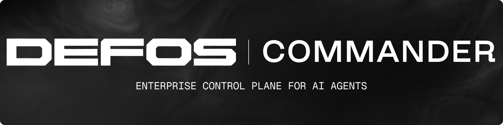

  

**DEFOS Commander is the enterprise control plane for AI agents.**

Build, connect, orchestrate, and govern distributed AI agents across complex missions. Integrate existing agents without rebuilding them, automate predictable steps, delegate decisions to AI or people, and track execution, results, and artifacts in one place.

Run missions and operations lasting months, orchestrating agents with different models and levels of intelligence.

What are the use cases for Commander? [Ask ChatGPT](https://chatgpt.com/?q=What%20are%20the%20use%20cases%20for%20defos-ai/commander?)

## Quick start

Follow [Installation](docs/installation.md) for native setup, or
[Deployment](docs/deployment.md) for Docker and Compose.

Ask your coding agent:

> Install Commander (`defos-ai/commander`) and connect it to this coding agent using `commander start` and `commander setup --json`. Show me the setup plan for approval, then verify the installation and suggest how Commander can help with my work and projects.

Or open Playground, choose a model, enter its API key, and ask:

> Create a Hacker News digest

The demo saves a topic-focused reading list as Markdown and JSON.

## Learn more

[Documentation](docs/README.md) · [Use cases](docs/use-cases.md) · [Releases](docs/releases/README.md) · [Contributing](CONTRIBUTING.md)

[Security](SECURITY.md) · [Code of Conduct](CODE_OF_CONDUCT.md) · [AGPL-3.0-only](LICENSE)
