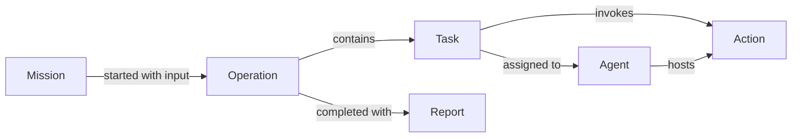

# Core abstractions

Commander separates the objective, the work performed, and the processes that
coordinate it. This guide describes the current model.

## Mission, operation, and task

| Concept | Meaning | Example |
| --- | --- | --- |
| **Mission** | A reusable definition of an objective, expected input/output, required actions, optional planning steps, and automation rules. | “Review a website before release.” |
| **Operation** | One tracked run of a mission with specific input. It owns tasks, questions, progress, and the final output. | Review the staging website today. |
| **Mission step** | Planning guidance within a mission. A task can reference a step, and several tasks can contribute to it. | “Check page quality.” |
| **Task** | One queued or dispatched action assignment within an operation; the controller selects its agent at dispatch. It records the outcome and observation deadline. | Capture a page with an available web quality agent. |

A mission can have many operations. Each operation keeps a snapshot of its mission,
so editing the catalog does not rewrite an existing operation's definition.
Input and output schemas describe the JSON values accepted when starting and
completing the operation.

Mission steps guide the decision maker; they do not automatically execute as a
workflow. An operation can be created with missing requirements, but its tasks wait
for [preflight](#discovery-and-preflight). The controller runs tasks selected through
the adapter.



An operation has its own UUID. A caller may supply a canonical lowercase UUID
as `operation_id` when starting it, or let Commander generate one. Reusing an
existing operation ID returns a conflict. A caller-supplied ID allows lookup
after a lost reply. Each task also has its own ID.

## Who does what?

| Concept | Responsibility |
| --- | --- |
| **Decision maker** | Chooses what to do next, interprets results, answers questions, and decides when to finish. Typically an AI client guided by a user. |
| **Adapter** | Connects an external client to Commander. MCP is the current implementation; it sends commands and queries saved data. |
| **Controller** | Coordinates agents, dispatches commands, accepts results, and maintains durable execution records. |
| **Runner** | The framework component used by the controller to manage operations, tasks, questions, reports, and recovery. |
| **Agent** | A worker that advertises available actions, executes commands, stores artifacts, and publishes results and status. An agent does not need to contain an LLM. |
| **Host** | The executable that configures a runtime, opens providers, and manages startup and shutdown. |

Agent **type** identifies its implementation, such as `web-quality`; agent
**ID** identifies one running instance. Multiple agents can share a type.
Controllers and adapters likewise have types and instance IDs.

In `domain/agents`, `AgentSnapshot` is the state reported by the agent.
`current_work` identifies the reported action, operation, task, and command; it is
cleared when execution ends. `Agent` adds heartbeat freshness and lease expiration;
`AgentStore` persists it. Work reported by a stale agent is its last known state.

## Actions, environment, and permissions

- **Action:** an agent capability with a name, description, input/output schemas,
  required permissions, and readiness status. Each task invokes one action.
  `discover-pages`, `check-links`, and `capture-page` are action names; there is no separate
  capability-name catalog. Missions refer to `required_actions` and `starting_actions`.
- **Environment:** installed executables and deployment configuration used by an
  action. Actions can use Go code, programs such as Chromium, or external APIs. Each
  action checks its own dependencies and reads settings through `Environment.LookupEnv`.
- **Readiness:** `unknown` before discovery, `ready` when local requirements are
  satisfied, or `unavailable` with a public `status_reason`. Missing dependencies
  leave the other actions usable. Readiness does not guarantee a remote service
  will accept a credential or succeed on every call.
- **Permission:** an explicit host grant, such as `network-access` or
  `execute-command`. Discovery does not grant permission; execution checks grants.
- **Inventory:** the controller's view of agents, their actions, readiness, and
  recent heartbeats. Heartbeats indicate liveness, not task completion.

MCP still exposes **tools**, its protocol endpoints. Commander tools such as
`assign_task` and `list_actions` operate on agent actions. Work specifies
`action_name` and `input`; the controller selects an eligible agent. Agent queries
still expose instance details, while agent administration stays in controller code.

## Results, artifacts, questions, and reports

| Concept | Meaning |
| --- | --- |
| **Action result** | The structured output of an action, plus any artifact references. Failures carry an error instead of a successful result. |
| **Artifact** | A database record describing evidence produced by an action: its identity, owner, creation time, and file descriptors. One artifact can group several files. |
| **Artifact file** | Bytes such as a screenshot, download, or detailed JSON evidence. Stored separately through `ArtifactFileStore`; its descriptor records the name, media type, size, and checksum. |
| **Question** | A request for operator intervention when the model cannot proceed. It can pause a linked continuation, a mission step, or the operation; dispatched tasks continue. |
| **Report** | The final output saved when an operation is explicitly completed. It has its own ID and belongs to that operation. |

Finishing a task does not automatically complete its operation. The decision maker
can inspect the result, assign more tasks, ask questions, or submit a final report.

## Next actions and continuations

An action can return optional **`next_actions`**: proposals for follow-up actions,
each with an `action_name`, optional `input`, and `reason`. For example,
page discovery can suggest quality checks for each page. Multiple proposals
are independent; their list order does not define execution order or dependencies.
They do not authorize execution.

Every finished or interrupted task has a **continuation**, exposed through
`get_operation` under `tasks[].continuation`. The operation can mix decisions by:

- `code`: a mission rule selects follow-up tasks automatically.
- `model`: the external AI client chooses actions or finishes the branch.
- `user`: the model has requested operator intervention through a linked question.

A continuation is `pending`, `waiting` for children or an operator, or `resolved`.
Its `version` prevents competing decisions from both being accepted.
`created_task_ids` links generated work to its parent; each child also records
`parent_task_id`. An empty proposal list returns to the model for a decision,
even when the action has an automatic mission rule.

`resolve_continuation` saves a model decision and all its queued tasks in one
operation update. Send `actions: []` to finish the branch. Repeated or stale
versions are rejected; refresh `get_operation` before making another decision.
Explicit operation completion closes remaining model decisions, but requires
queued/running work and pending questions to finish first.

A linked `ask_question` changes the decision maker to `user`. The adapter's AI
client presents it to the operator. `answer_question` records their actual answer
and returns the decision to `model`; it never dispatches work. Commander does not
independently verify human authorship of the answer. Unlinked questions can still
pause an entire operation or mission step.

Question status is `pending`, `answered`, or `expired`. Status controls its
lifecycle; `asked_at` and `answered_at` record its history, while `expires_at`
defines the answer deadline.
Questions accept up to four options or a free-text answer. They expire after
two minutes by default; `timeout_seconds` can set another deadline. On expiry,
the controller sets status to `expired` and returns the linked decision to the model.
The question remains in history without an operator answer; silence is not approval.
MCP exposes the latest pending question as `last_question` and the number of other
pending questions as `remaining_questions`. Playground presents them one at a time.

Agents propose actions, while mission rules authorize automatic action
transitions. Queued work is persisted before dispatch. The current scheduler
selects available agents in round-robin order with one active task per agent by
default. This limit applies within one runner; it is not shared across controller
replicas.

For grouped work, the controller waits for all children before applying their
own automation rules. If every child qualifies, follow-ups are queued together;
otherwise the parent exposes one model decision with the collected proposals.
Failed and interrupted children remain visible. Collection does not itself
require model review; see
[mission automation](#mission-automation)
and the [website review workflow](../apps/agents/web-quality/README.md#workflow).
Scheduling currently supports a single controller host;
replica coordination and distinct network egress are separate concerns.

See [proposing follow-up work](../apps/agents/README.md#propose-follow-up-work)
for the action author API.

## Mission automation

Define `automations` on a mission, keyed by the action that just finished:

```json
"automations": {
  "discover-pages": {"run": ["check-links", "check-accessibility", "capture-page", "check-seo", "detect-technologies"], "continue": "when_all"},
  "check-links": {"decide": "model"},
  "check-accessibility": {"decide": "model"},
  "capture-page": {"decide": "model"},
  "check-seo": {"decide": "model"},
  "detect-technologies": {"decide": "model"}
}
```

The same rules in Go use `missions.Automation`:

```go
Automations: map[string]missions.Automation{
    "discover-pages": {Run: []string{"check-links", "check-accessibility", "capture-page", "check-seo", "detect-technologies"}, Continue: missions.WhenAll},
    "check-links": {Decide: missions.Model},
    "check-accessibility": {Decide: missions.Model},
    "capture-page": {Decide: missions.Model},
    "check-seo": {Decide: missions.Model},
    "detect-technologies": {Decide: missions.Model},
},
```

- `run` accepts next-action proposals only for the listed actions. Inputs come from
  those proposals; the rule does not invent work. No proposals returns control to
  the model.
- `continue: "when_each"` (the default) lets each child continue as it finishes.
- `continue: "when_all"` collects generated siblings before applying their rules.
  All must qualify for automation; otherwise the group needs one model decision.
- `decide: "model"` requests a model decision. Unconfigured actions, failures, and
  unapproved proposals also require a model decision. The model asks the operator
  when it needs intervention.

Rules are validated with the mission and captured in each operation's mission
snapshot. Changing the mission affects new operations; existing operations keep
using their saved rules through restart. Missions without automation stay model
controlled. Starting an operation still requires an initial task assignment, and
operation completion remains explicit.

For the FS provider, definitions live in `DATABASE_URL/missions.json`.
`list_missions` exposes the rules through MCP. Definitions can be upserted through
the mission store or loaded at startup with the controller's
[`--with-missions` flag](../apps/controllers/README.md#quick-start)
(there is no MCP mission-edit command).

## Discovery and preflight

Discovery runs on the agent. An action reports its readiness and
`missing_requirements`: executable names, configuration keys, or permissions.
Configuration requirements can be marked `secret`; values never belong in this
metadata. Action discovery does not install software or change configuration.

The controller checks the mission's `required_actions` and each step's required
actions against live agents. Different agents can provide different actions;
`starting_actions` guides initial assignments and does not reduce preflight coverage.
A busy agent still provides coverage, while capacity is checked separately at dispatch.

`start_operation` saves `preflight` with the operation. Each entry in `actions`
has `ready_agent_ids`, or `unavailable_agents` with reasons and missing requirements.
If both lists are absent, no agent advertises that action. Missing requirements put
the operation in `waiting` before dispatch. Tasks can be queued while waiting;
inventory updates refresh preflight and resume those tasks when coverage is ready.
Already running tasks continue. Only changed preflight results advance its version
and produce an `operation.preflight_updated` event.

MCP exposes preflight in operation responses. Playground brings blocked preflight
to the model for explanation or an operator question. Installation and credential
configuration are not implemented by this check; supplying dependencies remains a
host operation followed by action rediscovery.

## Messages and durable execution

- **Command:** a serializable instruction, such as starting an operation or running an action.
- **Event:** a notification about something that happened, such as an agent heartbeat
  or action completion. Operation history also records events for progress queries.
- **Message:** the bus envelope carrying a command, event, or reply, together with
  delivery identity, correlation, and routing information.
- **Execution record:** a durable reservation for an action command and its received
  outcome. It supports recovery and recognizes repeated commands. A reservation
  alone does not prove the agent executed the action.
- **Result receipt:** the controller's confirmation to an agent that its result is
  durably stored. A broker acknowledgement only confirms message processing.

An operation can be `planning`, `running`, `waiting`, `completed`, `failed`, or
`cancelled`. Task status is separate: an `interrupted` task has an unknown execution
outcome. Cancelling an operation prevents new assignments; already dispatched work
may still finish. See [restart recovery](overview.md#state-and-restart-recovery)
for how saved outcomes are reconciled.

## Infrastructure

- **Bus:** transports messages between adapters, controllers, and agents.
- **Store:** an interface for reading or persisting a particular kind of data,
  such as operations, reports, or artifacts.
- **Provider:** an implementation of those infrastructure interfaces; see
  [existing providers](../providers/README.md#existing-providers).

See the [architecture overview](overview.md) for application dependencies,
[message contracts](../framework/comms/messages/README.md) for exchanges, and
[providers](../providers/README.md) for infrastructure implementations.
