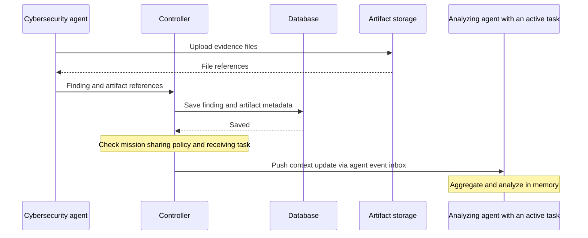

# Context sharing

**Status: mission policy can be saved; live publication and delivery are planned.**

Let agents share findings within an operation while work is running:

1. Cybersecurity agents discover vulnerabilities and publish findings and evidence.
2. The controller saves them and forwards permitted updates to an analyzing agent.
3. The analyzer aggregates the updates in memory and analyzes vulnerabilities as
   they arrive, without waiting for the whole operation to finish.

## Mission policy

The mission names producing and receiving actions. The controller selects the
receiving agent and its active task execution. Configuration:

```json
{
  "context": {
    "sharing": [
      {
        "from_actions": ["find-vulnerabilities"],
        "to_actions": ["analyze-vulnerabilities"],
        "include": ["results", "artifacts"]
      }
    ]
  }
}
```

Each route requires producing actions, receiving actions and at least one of
`results`, `artifacts` or `decisions`. Omit `context` or leave `sharing` empty to
declare no routes. Each operation keeps its mission's policy snapshot; editing
the mission affects future operations. Saving policy does not enable delivery yet.

Results, decisions and artifact metadata are saved normally, whether sharing is
enabled or not. Enabling sharing adds forwarding to matching receiving tasks in
the same operation. Relevant non-secret decisions can also be included, retaining
whether an operator or model answered and the decision's original scope.

## Delivery



**Database** means Commander's configured database provider. Artifact files live
separately in S3-compatible or filesystem storage; messages carry finding data and
file references rather than the file contents.

After saving evidence, the controller pushes permitted updates to the receiving
agent's event inbox through the existing messaging bus. The framework delivers
them to the running action without polling. Start the analyzing task before
scanners publish findings.

A finding may be published while its producing action is still running. Such an
update does not complete that action or replace its final result. Updates retain
stable IDs and source information so receivers can ignore duplicate deliveries.

## Agent-owned memory

Receiving agents own aggregation and state. Start with process memory, kept
separate for each operation. The controller routes evidence without managing
the analyzer's accumulated memory.

The analyzer runs as a normal controller-assigned task. Sharing does not start
arbitrary work, extend task deadlines, or deliver updates to completed executions.
Managed secrets, execution checkpoints, raw execution logs and private chat
history stay outside automatic sharing.

The first scope is live delivery and in-memory aggregation. An analyzer restart
loses its local memory; replay and recovery are later work. Saved evidence remains
available, but persistence alone does not confirm delivery.

Controller filtering alone cannot isolate agents that already have broad access
to shared artifact storage. Strong isolation needs scoped storage access or
controller-mediated artifact retrieval.
