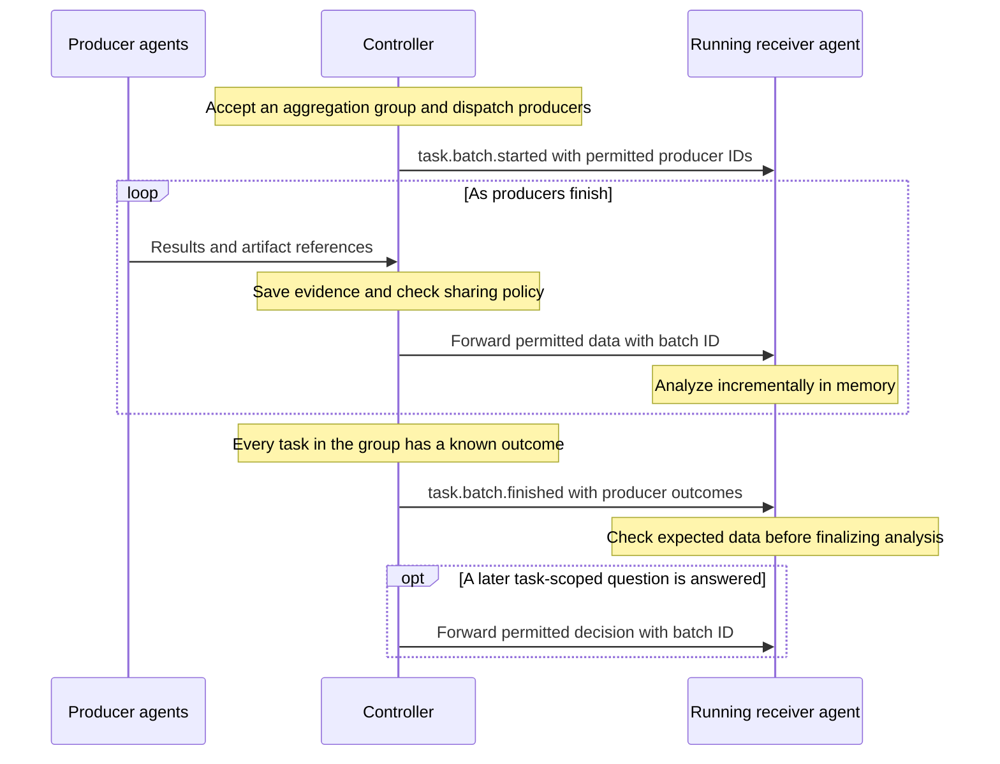

# Data sharing

Send findings, evidence and answered questions from one action to another in the
same operation. For example, security agents can share vulnerabilities with an
analyzing agent while other checks continue.



## Enable sharing

Choose registered producer and receiver action names. The receiver must support
shared-data consumption. In Admin's mission JSON editor, or through API/MCP,
add a sharing policy:

```json
{
  "policies": {
    "continuation": {
      "aggregate_results": ["discover-targets"]
    },
    "sharing": [
      {
        "from_actions": ["find-vulnerabilities"],
        "to_actions": ["analyze-vulnerabilities"],
        "include": ["results", "artifacts", "decisions"]
      }
    ]
  }
}
```

Replace these example action names with your agents' capabilities. Include only
what the receiver needs: `results`, `artifacts`, and/or `decisions` (answered
task-scoped questions). Save the mission before starting an operation; edits
apply to new operations. Omit `policies.sharing` to disable sharing.

For batch boundaries, put the action that proposes producer tasks in
`continuation.aggregate_results` (`discover-targets` here). Existing sharing
routes carry the boundaries automatically. Independently assigned producers can
still share data without batch notifications.

## Run the operation

1. Start an operation using the configured mission.
2. Assign the receiving action first and wait until it is running. Keep it outside
   the producer group and keep separate agent capacity available for producers.
3. Assign producer actions, or their proposing parent action, in that same
   operation. The controller forwards their
   permitted data automatically; successful results arrive after producer tasks
   finish. Artifact references let the receiver retrieve evidence from the shared
   artifact storage, which it must be able to access.
4. Review tasks, results and artifacts in Admin. Complete the operation through
   the normal review flow; shared decisions grant no additional approval authority.

The analyzer receives `task.batch.started` with its permitted producer task IDs.
Results, artifact references and decisions carry the same batch ID.
`task.batch.finished` reports succeeded, failed or cancelled outcomes for those
producers. It waits for the whole group to settle, including unrouted tasks.
Interrupted outcomes remain unknown and keep the batch open.

Delivery is live and best effort. Only running receiver tasks receive updates;
batch boundaries and results go to receivers selected at start. Decisions continue
following live sharing routes, including after finish. A finish signal does not
prove all data arrived; compare it with the expected producers.
Controller restarts lose batch enrollment; receiver restarts lose local data.
Neither replays earlier updates or boundaries. Sharing does not start tasks or
extend their deadlines. Managed secrets stay in the separate secret-delivery flow.
