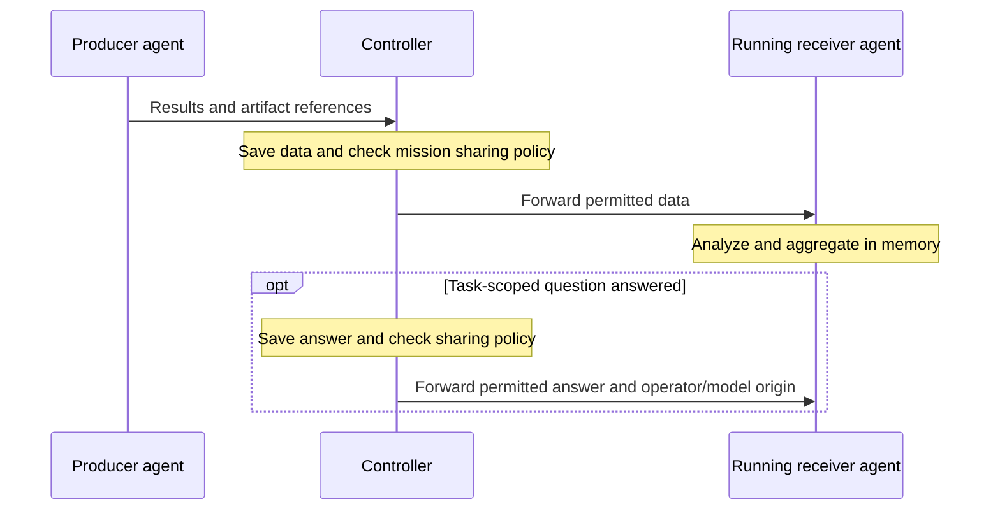

# Data sharing

Send findings, evidence and answered questions from one action to another in the
same operation. For example, security agents can share vulnerabilities with an
analyzing agent while other checks continue.



## Enable sharing

Choose registered producer and receiver action names. The receiver must support
shared-data consumption. In Admin's mission JSON editor, or through API/MCP,
add a sharing policy:

```json
{
  "policies": {
    "sharing": [
      {
        "from_actions": ["find-vulnerabilities"],
        "to_actions": ["analyze-vulnerabilities"],
        "include": ["results", "artifacts", "decisions"]
      }
    ]
  }
}
```

Replace these example action names with your agents' capabilities. Include only
what the receiver needs: `results`, `artifacts`, and/or `decisions` (answered
task-scoped questions). Save the mission before starting an operation; edits
apply to new operations. Omit `policies.sharing` to disable sharing.

## Run the operation

1. Start an operation using the configured mission.
2. Assign the receiving action first and wait until it is running. Keep separate
   agent capacity available for producer tasks.
3. Assign producer actions in that same operation. The controller forwards their
   permitted data automatically; successful results arrive after producer tasks
   finish. Artifact references let the receiver retrieve evidence from the shared
   artifact storage, which it must be able to access.
4. Review tasks, results and artifacts in Admin. Complete the operation through
   the normal review flow; shared decisions grant no additional approval authority.

Delivery is live and best effort. Only running receiver tasks receive updates;
restarting a receiver loses its in-memory context and does not replay earlier
data. Sharing does not start tasks or extend their deadlines. Managed secrets
stay in the separate secret-delivery flow.
