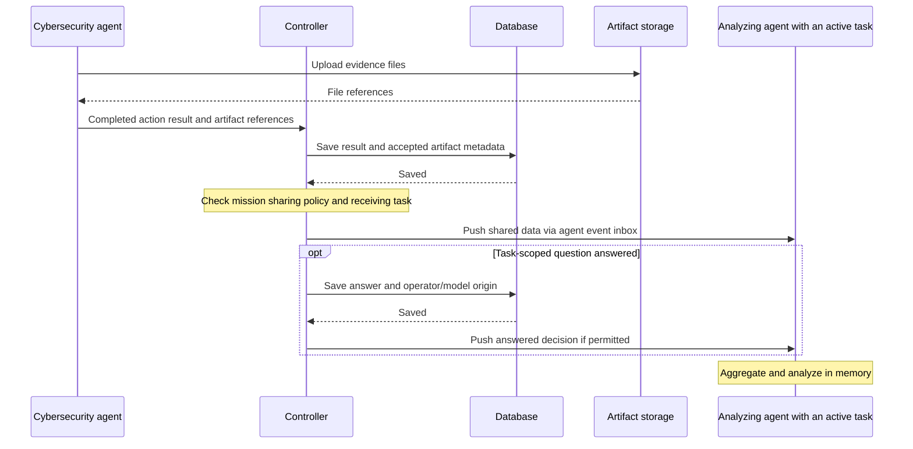

# Data sharing

**Status: live forwarding of results, artifacts and answered decisions is available.**

Share saved results, artifact references and answered decisions between actions
in the same operation. Receiving agents use that data to build their own working
context. For example:

1. Cybersecurity actions return vulnerability findings and evidence.
2. The controller saves their results and accepted artifact metadata normally,
   then forwards permitted data to an analyzing agent.
3. The analyzer aggregates the updates in memory and analyzes vulnerabilities as
   producer actions finish, while other tasks in the operation can continue.

## Mission policy

The mission's `policies.sharing` names producing and receiving actions. The
controller selects the receiving agent and its active task execution.
Configuration:

```json
{
  "policies": {
    "sharing": [
      {
        "from_actions": ["find-vulnerabilities"],
        "to_actions": ["analyze-vulnerabilities"],
        "include": ["results", "artifacts"]
      }
    ]
  }
}
```

Each sharing policy requires producing actions, receiving actions and at least
one of `results`, `artifacts` or `decisions`. Omit `policies` or
`policies.sharing`, or leave the sharing list empty, to disable sharing. Each
operation keeps its mission's policy snapshot; editing the mission affects
future operations. Receiving actions must already be running.

Results, decisions and artifact metadata are saved normally, whether sharing is
enabled or not. Sharing reuses those records and adds forwarding to matching
receiving tasks in the same operation. The `decisions` option shares non-secret,
task-scoped answered questions after the answer is saved, retaining the question
ID, original scope, answer and operator/model origin. It covers questions asked by
running actions and questions linked to task continuations. Operation-wide
questions stay outside sharing; receiving a decision grants no approval or authority.

## Delivery



**Database** means Commander's configured database provider. Artifact files live
separately in S3-compatible or filesystem storage; messages carry finding data and
file references rather than the file contents.

After accepting and saving evidence, the controller pushes permitted data to the
receiving agent's event inbox through the existing messaging bus. The framework
delivers it to the running action without polling. Start the analyzing task before
producer actions finish.

Updates retain existing task, command, artifact or question IDs and source
information so receivers can ignore duplicate deliveries. Forwarding uses the
existing saved records without another persistence layer.

A running action uses [`action.ReceiveContext(ctx)`](../../framework/agent/action/context.go)
to wait for the next pushed update. Reception ends with the execution or its
deadline. A full buffer reports an error so the analyzer can report incomplete
data rather than silently continue.

## Agent-owned memory

Receiving agents own their context, aggregation and state. Start with process
memory, kept separate for each operation. The controller forwards saved data
without managing the analyzer's accumulated memory.

The analyzer runs as a normal controller-assigned task. Sharing does not start
arbitrary work, extend task deadlines, or deliver updates to completed executions.
Managed secrets, execution checkpoints, raw execution logs and private chat
history stay outside automatic sharing.

Delivery is live and aggregation stays in memory. Forwarding failures and overload
are logged without changing accepted results or saved answers. An analyzer restart loses its local
memory; replay and recovery are later work. Saved evidence remains available, but
persistence alone does not confirm delivery.

Controller filtering alone cannot isolate agents that already have broad access
to shared artifact storage. Strong isolation needs scoped storage access or
controller-mediated artifact retrieval.
