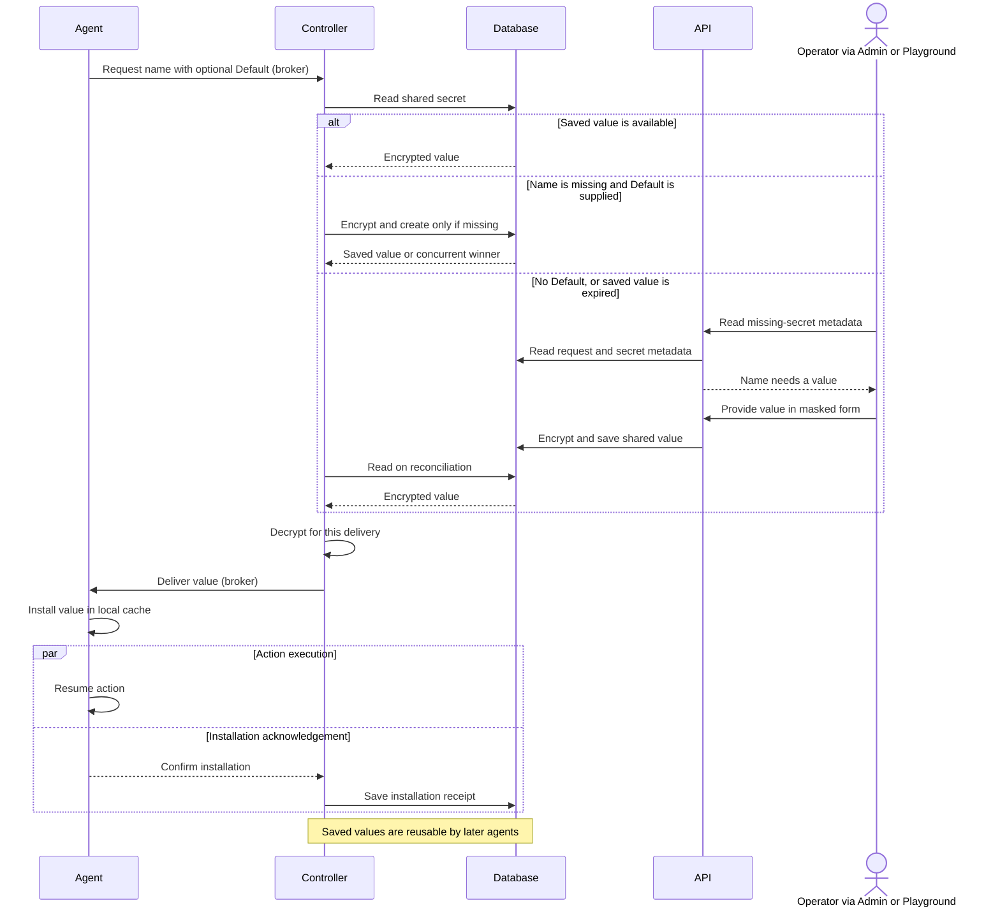
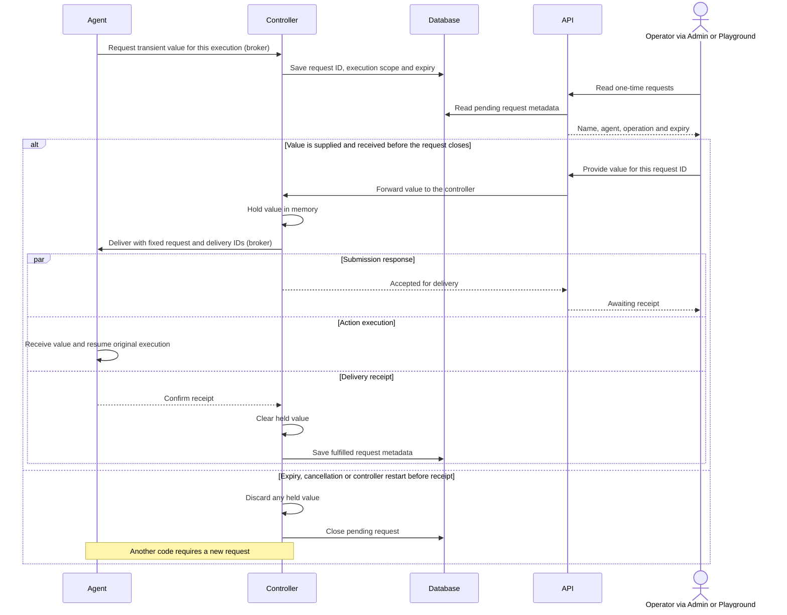

# Secrets

Open **Admin → Secrets** to save a credential under the name requested by an
action, such as `OPENAI_API_KEY`. Save it once: agents requesting that name share
the same deployment-wide value, including agents started later.

## Provide a value

1. Open **Secrets** on the operation's API connection, or choose **Manage secrets**
   from a missing-secret notice.
2. Enter the requested name and value in the secret form. Set an expiration if
   needed, then save.
3. Wait for the action's missing requirement to clear. Saving confirms storage;
   work resumes only after the agent installs the delivered value.

In Playground, use the masked form that opens when needed. **Tab** moves between
fields, **Enter** advances or saves, and **Esc** postpones. Type `/secrets` to
reopen it, or set a named value directly:

```text
/admin secrets set OPENAI_API_KEY
```

Enter the value in the local masked prompt. Never paste credentials into chat,
question answers, mission definitions, action inputs, logs or checkpoints.
The form sends values directly to the API, outside the model. Secret values are
write-only: API reads and Admin inventories return metadata, not stored values.

## When work needs a secret

- **Before starting:** an action can declare required names. A missing or expired
  value keeps it unavailable and can hold operation preflight until delivery.
- **While running:** an action can request a name only when its input needs it.
  Provide it through the same form and let the existing execution resume. Its
  task deadline keeps running; do not start replacement work just to supply a key.

## Reusable flow

Reusable values, such as API keys and CRM logins, are shared by name. An agent can
supply a `Default` from its code, environment or memory. Existing values take
precedence; an expired value needs operator replacement.



A valid local copy can be reused until its lease expires. Saving a default never
overwrites an existing value; callers waiting for the same name share one pending
request within an agent.

## One-time values

Open **Admin → Secrets → One-time requests** for verification codes and other
temporary values. Choose the request for the correct agent and operation, enter
the value before its expiry, then choose **Send value**. These values are not
saved for reuse.

**Awaiting receipt** means delivery is in progress. **Received by agent** confirms
arrival, not that a website accepted it; inspect the operation for the outcome.
After an uncertain submission, use **View status** and **Check status**.
Closing or reopening the form does not resend the value. Expired requests stay
closed; let the agent decide whether another code is needed.

Playground opens a separate **One-time secret** form for a watched execution.
Check its operation, agent and expiry before entering the value. Use `/secrets`
to reopen it and **R** to check status. Dismissing or reopening never resends a
submitted value. Closing Playground discards any unsent draft.

### Transient flow

Transient values, such as verification codes, belong to one request and execution.
The database retains request and receipt metadata; the value stays out of reusable
storage and the agent-wide cache.



Receipt confirms arrival, not acceptance by a website. Action completion may
precede the receipt; the controller keeps only delivery metadata for a matching
late receipt until the original expiry. Transport retries keep the same IDs and
value, while an uncertain submission calls for a status check.

## Replace, expire or delete

Use **Secrets** to replace a value, change its expiration or delete it. Refresh
metadata after conflicts or uncertain writes before submitting another change.
With default agent settings, declared values refresh about every 30 seconds and
installed leases last up to one minute; updates are not immediate revocation.

Deletion does not cancel actions, revoke values an action already copied, or
remove encrypted delivery history. Deliveries already in flight can still arrive.
Plan backups and retention for that history as well as the primary secret store.

## Playground model keys

A key entered for Playground's own model is remembered encrypted on that machine.
A provider environment variable, such as `OPENAI_API_KEY`, overrides the remembered
key. Playground does not retrieve stored secret values from Commander's API.

After connecting with an API login, Playground also saves its selected provider
key under that environment-variable name if no shared value exists. Existing
shared values stay unchanged. Use the secret form to replace them explicitly.
Without that login, `/admin secrets set NAME` prompts for the API connection.

## Deployment setup

Compose and all-in-one configure encryption automatically. Standalone API and
controller hosts need the same retained [encryption key](../../apps/adapters/api/README.md#secrets).
Retain and back up the key; restoring encrypted data requires the original key.
Agents receive requested values without that key. Shared names are
not per-agent access controls: run trusted agents, protect broker access, and use
AMQPS for secret delivery across networks.

See [Playground setup](../../apps/playground/README.md) and
[agent integration](../../framework/secrets/README.md) for configuration and code.
