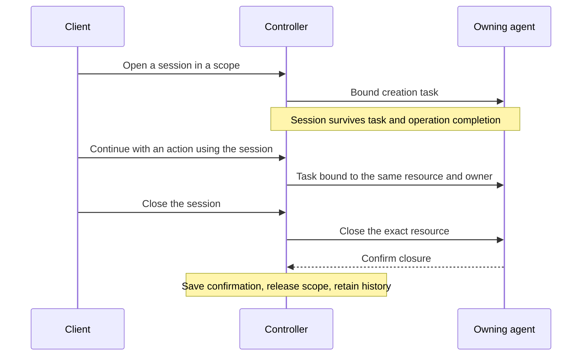

# Sessions

Keep an agent-owned resource, such as a Builder workspace, browser or shell connection, across
actions and operations. Open **Admin → Sessions** to inspect resources and their
owners, or use [Admin commands](../../apps/admin/README.md#sessions), also
available in Playground through `/admin sessions`.

## Open and use

For Builder, assign `checkout-template` with `{}`. Review its result, then resolve
its continuation with `build-agent`, supplying instructions and action contracts.
The controller keeps the workspace session and routes build to its exact owner.
Session-aware continuations retain their direct parent's session. Session IDs
are metadata for inspection and control; do not put them in action inputs.
Mission policies do not supply session bindings.

After finishing a branch, reuse its resource with `assign_task` (or HTTP task
assignment) and `session_task_id` set to a finished session task in the same
operation. This creates independent work using the same resource and owner;
it does not reopen the earlier continuation. Keep action input free of session IDs.

```json
{"operation_id":"<operation-id>","action_name":"<use-action>","session_task_id":"<finished-task-id>","input":{}}
```

Session-capable actions declare `session_mode` in their definition:

| Action mode | Behavior |
| --- | --- |
| `open` | Open a new session or continue setup of the inherited session on its owner. |
| `use` | Use the inherited connected session on its owner. |

Scope and session IDs are canonical UUIDs. A scope permits one current reservation;
it can span operations and need not represent a chat. The owner is one exact
agent process, not an agent type. A restarted agent cannot inherit its sessions.
Session IDs select resources; they do not grant access.

Before reuse, inspect state, lifecycle disposition, busy status and action
readiness. Check `session_intent` and `preflight.tasks` for placement blockers;
`preflight.ready` alone does not establish session usability.

## Lifecycle



| Mechanism | Lifetime and purpose |
| --- | --- |
| Session | Retains a resource and its owner across operations until release. |
| Execution checkpoint | Records an immutable execution fact; it does not control session lifetime or authorize repeating an effect. |

Builder checkout creates a workspace session; its build continuation inherits it.
Closing the session stops access and active work
while retaining the workspace files. Different sessions can have different owners
within the same operation.

## Queries and controls

Admin shows current sessions and retained closed or abandoned history. Listing a
session does not guarantee it is ready for work.

| Control | Use it to… |
| --- | --- |
| `inspect` | Read saved state and ownership. |
| `verify` | Check the resource through its owner. |
| `close` | Stop the resource and release its scope after confirmed closure. |
| `abandon` | Release a lost or failed session for replacement while accepting that its old resource may still exist. |

Authenticated HTTP provides:

- `GET /api/v1/sessions`, optionally filtered by `scope_id` and/or `owner_agent_id`.
- `GET /api/v1/sessions/<session-ID>` for one saved session.
- `POST /api/v1/sessions/control` with
  `{id, owner_agent_id, scope_id, method, request_id?}`.

MCP provides `list_runtime_sessions` with the same optional filters, and
`control_runtime_session` with the control fields above. Reuse a stable UUID
`request_id` when reconciling a control. After a timeout, inspect saved state
before submitting again; a timeout does not prove closure.

## Recovery and limits

- Completing or cancelling an operation does not close an existing resource.
  A failed action or an unreachable owner does not prove the resource stopped.
- Pending close retains the scope until the owner's confirmation is saved.
  Confirmed close prevents delayed setup from reopening the same reference.
- Abandonment retains history and sends revocation to the old owner when possible.
  An unreachable owner may still execute already-delivered work. Replacement
  never redirects tasks that reference the old session.
- Recovery reconciles saved intent, ownership and execution before dispatch.
  Unknown outcomes retain the original command and owner; checkpoints do not
  authorize an automatic retry elsewhere.
- One active controller per database is supported.

For agent integration and validation, see the framework's
[provider contract](../../framework/sessions/AGENTS.md#provider-contract),
[recovery invariants](../../framework/sessions/AGENTS.md#checkpoints-and-recovery)
and [E2E checks](../../framework/sessions/AGENTS.md#e2e-checks).
