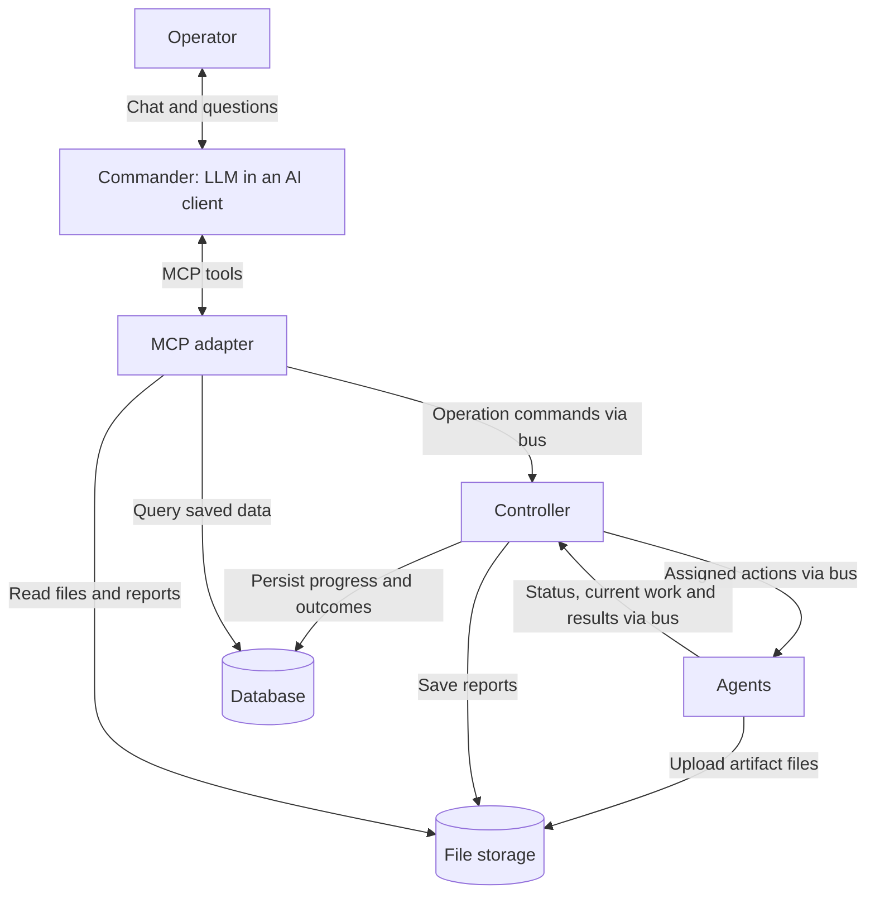
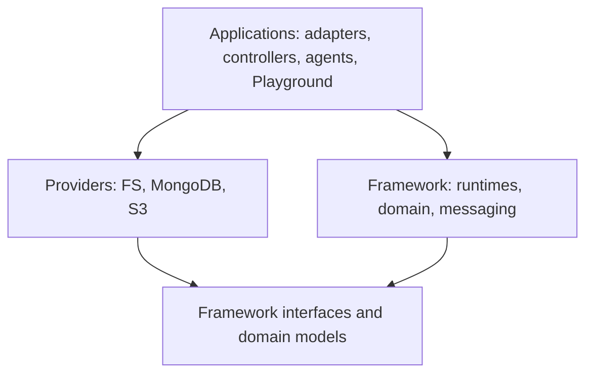

# Architecture overview

**Commander decides what; the controller decides who; agents execute.**
Commander is usually an LLM in Playground or another AI client, connected through
MCP. The current controller and agents run without their own LLMs.

## Execution flow

For the included website review:

1. Commander reads `review-website`, starts an operation, and assigns `discover-pages`.
2. The controller checks required actions against live agents and selects a ready
   instance with free capacity. Assignments specify an action and input, not an agent ID.
3. Discovery proposes checks for each page. The mission's automation queues those
   checks without another model call; the controller distributes them across agents.
4. Agents publish results. The controller saves outcomes and artifact metadata
   before confirming acceptance; file bytes stay in storage.
5. Commander reviews collected results, requests operator guidance if needed,
   and explicitly completes the operation with a report.

MCP exposes operation commands and queries, including agent readiness and current
`work`. The controller owns instance selection and agent administration. Only MCP
opens an HTTP port; controllers and agents consume messages. See
[core concepts](abstractions.md) for tasks, automation, questions and evidence.

## Dependencies

Hosts construct providers and inject interfaces. The framework imports no providers
or applications. Runtimes communicate through shared contracts without importing
each other; Playground can compose the hosts in all-in-one mode.

| Area | Responsibility | Details |
| --- | --- | --- |
| `framework/` | Shared runtime behavior, domain models and interfaces | [Framework](../framework/README.md) |
| `apps/` | Concrete hosts, actions and client experience | [Agents](../apps/agents/README.md), [controllers](../apps/controllers/README.md), [adapters](../apps/adapters/README.md), [Playground](../apps/playground/README.md) |
| `providers/` | Messaging, database and file-storage implementations | [Providers](../providers/README.md) |

## State and restart recovery

The database stores progress, inventory and artifact metadata; file storage holds
artifact bytes and reports. Processes also retain subscriptions, active calls and
scheduling state: they are not entirely stateless.

| Failure | Current behavior |
| --- | --- |
| MCP restarts | Coordination continues. Saved data remains queryable; a lost command reply does not prove the command failed. |
| Controller restarts | It reloads operations, reconciles saved outcomes and resumes queued work. A saved dispatch may be replayed only to its original live agent using the same command ID. |
| Agent dies | Its heartbeat expires. Undispatched tasks can use other ready agents; an unknown outcome from dispatched work is not silently rerun on a replacement. |

The agent's command deduplication and pending result cache last for that process's
lifetime. Interrupted tasks are checked against durable outcomes; if none exists,
they remain interrupted for review. This is not an exactly-once execution guarantee.

## Current scope

- **One active controller per database.** Multiple-controller ownership and shared
  capacity reservations are not implemented.
- **Implemented providers:** filesystem bus/database/files, RabbitMQ messaging,
  MongoDB database, and S3-compatible files/reports. Full Compose still uses MongoDB
  and MinIO with an FS bus; native hosts can select RabbitMQ through `BUS_URL`.
- **Hosts use transient inboxes.** Replacing a host does not replay its old inbox.
  RabbitMQ supports durable shared inboxes, but hosts do not activate them yet.
  FS retains failed delivery evidence without automatic redelivery.

See [message handling](../framework/comms/README.md),
[local setup](deployment.md), and [tests](../framework/tests/README.md) for the
current guarantees and ways to verify them.
