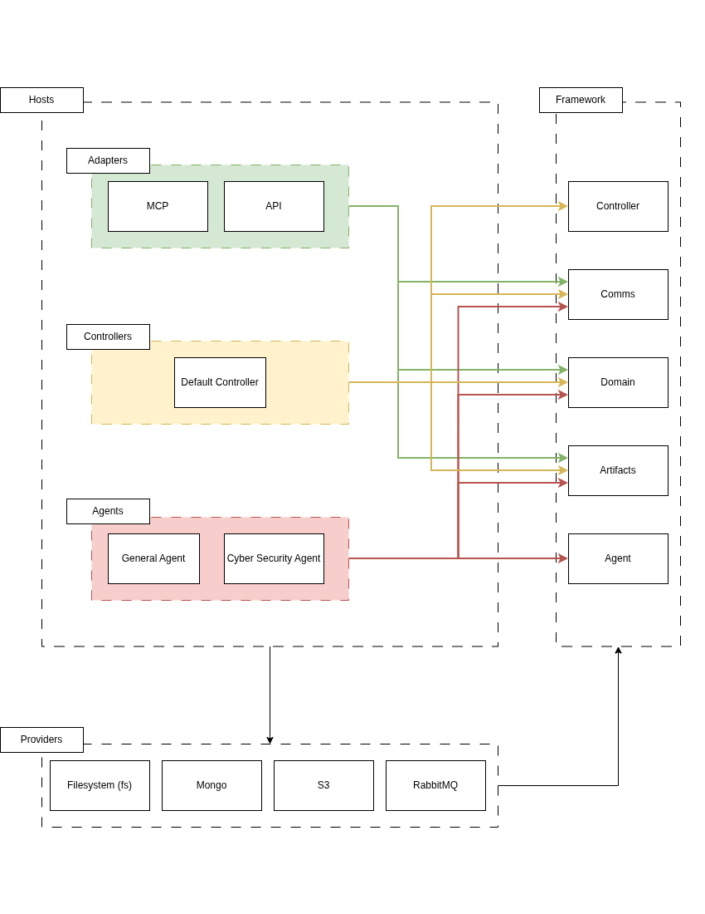

# Architecture overview

Commander separates client access, coordination, and action execution. Each runs
in its own application, built on shared framework contracts and infrastructure providers.

Read [core abstractions](abstractions.md) for missions, operations, tasks, agents,
and the other concepts used here.

## Components

| Layer | Current implementation | Guide |
| --- | --- | --- |
| Adapters | MCP | [Adapters](../apps/adapters/README.md) |
| Controllers | Default controller | [Controllers](../apps/controllers/README.md) |
| Agents | Cyber security agent | [Agents](../apps/agents/README.md) |
| Shared library | Framework | [Framework](../framework/README.md) |
| Infrastructure | Filesystem | [Providers](../providers/README.md#existing-providers) |

## Dependencies

[Editable diagram](dependencies.drawio).

Arrows represent code dependencies. Hosts construct providers and inject their
interfaces into framework runtimes. The framework imports neither providers nor
application hosts. Applications communicate through shared contracts rather than
importing each other's runtimes.

API, General Agent, MongoDB, S3, and RabbitMQ in the diagram are planned extensions;
see [available providers](../providers/README.md#existing-providers) for implemented backends.

## Execution flow

1. An AI client sends a request through MCP.
2. The adapter sends a command over the bus to the controller.
3. The controller records the operation and dispatches selected tasks to agents.
4. Agents run actions, upload artifact files, and publish results with artifact
   metadata. The controller saves outcomes and metadata in the database before
   confirming acceptance to the agent.
5. The adapter queries stores to show progress, questions, and reports to the client.

The AI client provides direction and handles model decisions. Host-configured
automatic transitions let the controller queue follow-up work without a model call. Commands and events are serializable contracts in
[`framework/comms/clients`](../framework/comms/clients/).
Only MCP opens an HTTP port; controllers and agents run as message consumers.

## State and restart recovery

State is shared through the bus, storage, and database configured in
[local setup](deployment.md#configuration). The adapter can query saved data while
the controller is stopped; commands require a running controller.

Restarting MCP leaves coordination running. The controller restores saved operations,
queued work, questions, and outcomes. Queued tasks resume scheduling. For running
tasks, a saved result is reused; otherwise the exact saved command can be redelivered
to its original live agent process. The agent's lifetime command ledger prevents
repeat execution. A replacement agent has a new ID and never receives that replay.
Interrupted tasks are checked against saved outcomes without redelivery. If no
definitive result is available, they remain interrupted for the model to inspect.

Run one active controller per database. Coordination between controller replicas
is not implemented. The filesystem bus currently requires live subscribers and
does not automatically redeliver retained messages after a restart. See [message contracts](../framework/comms/messages/README.md)
for delivery details and [local setup](deployment.md) to run the current system.
