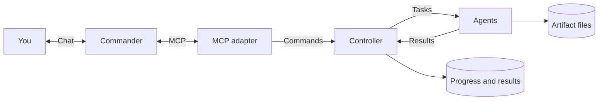

# Architecture overview

**Commander decides what; the controller decides who; agents execute.**
Commander is usually the model in Playground or another MCP client.

## Execution flow

For a website review:

1. Ask Commander to review a site.
2. Commander installs any missing agents and starts the review mission.
3. The controller sends checks to ready agents. Mission rules determine when
   Commander reviews their results.
4. Open the completed operation in Admin to inspect findings and screenshots.

Learn how to [create missions and choose rules](abstractions.md),
[build agents](../apps/agents/README.md), or [connect another client](../apps/adapters/README.md).

## Dependencies

| If you want to… | Start here |
| --- | --- |
| Extend runtimes or domain contracts | [Framework](../framework/README.md) |
| Add actions or change dispatch | [Agents](../apps/agents/README.md) · [Controllers](../apps/controllers/README.md) |
| Add a client integration | [Adapters](../apps/adapters/README.md) |
| Change messaging or storage | [Providers](../providers/README.md) |

All-in-one runs local hosts and child processes. Compose runs services and spawns
additional agents as sibling containers. Both start with builder and spawner.
See [setup](deployment.md) to choose a deployment.

## State and restart recovery

| What happened? | What to do |
| --- | --- |
| MCP or a client restarted | Reconnect and inspect the saved operation before repeating a command. Work may have continued. |
| The controller restarted | Check the operation's progress; it recovers saved work. Investigate any interrupted task before retrying. |
| An agent died | Inspect its tasks and external effects before assigning replacement work. Unknown outcomes are not automatically rerun elsewhere. |
| The spawner restarted | Docker children keep running. Inspect existing launches before requesting another instance; native launch recovery is not supported. |

Saved state helps recovery, but does not guarantee an action runs exactly once.
Keep the database, artifact storage and secrets encryption key together when
[backing up or resetting Compose](deployment.md#state).