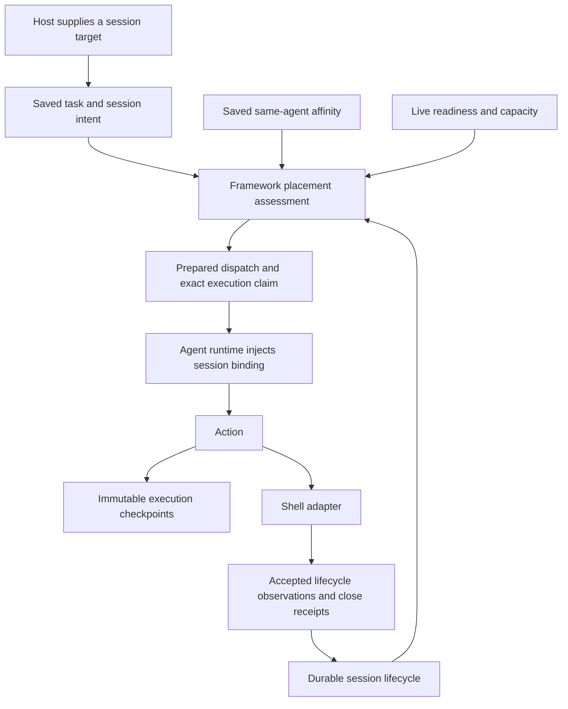

# Runtime session lifecycle in the Commander framework

Status: accepted and implemented on `feature/remote-shell-sessions`, based on
`d210c38` (Commander v0.2.0 and main at `b7ee2a9`). The source-linked
[usage contract](runtime-sessions.md) describes the implemented API. This document
records the ownership decision and recovery protocol.

The user selected explicit abandonment: a lost session may release its scope for
a fresh session without claiming the old resource was closed.

## Recommendation

Introduce a deep runtime-session module in the framework that owns durable
reservation, immutable process ownership, accepted lifecycle evidence, close and
abandonment. Give action authors a session binding supplied by the execution
context. Retain shell processes, verification and command framing in the shell
adapter.

The module's interface must hide the ordering across operation, session and
execution persistence. A thin registry with separate reserve/bind/release calls
would leave that protocol spread across callers.

Preserve the branch's initial scope: one current session reservation per scope,
sessions can outlive operations, and one active controller per database. A scope
is supplied by a host; it need not represent a chat. Session identity is not an
authorization credential; extension permissions and host authorization still apply.

## Three different lifetimes

| Concept | Authority | What it answers |
| --- | --- | --- |
| Runtime session | Durable session record | Which exact process owns this resource, and does it still reserve its scope? |
| `same-agent` affinity | Retained task dispatches in one operation | Which process must execute this operation's grouped actions? |
| Execution checkpoint | Immutable named fact in one execution | What did this execution record before or after an external effect? |

Completing an operation does not close a session. Closing or abandoning a session
does not erase an operation's affinity. Completing an execution prevents new
checkpoint names, but the session can continue changing.



## Interface alternatives considered

| Design | Interface shape | Depth, locality and trade-off |
| --- | --- | --- |
| Lifecycle coordinator | Prepare a dispatch; accept verified evidence; inspect/control a session | Highest leverage for framework callers: one module owns the persistence protocol. It deliberately depends on operation and execution contracts. |
| Session registry with a typed reducer | Accept domain changes; read a view; derive a constraint | Concentrates transition validation, but callers still coordinate admission, dispatch and recovery. A small method count hides a large protocol surface. |
| Execution-scoped binding | Action reads its binding; provider registers and operates the resource | Highest leverage for action authors. This seam alone cannot solve durable ownership or recovery. |

Use the coordinator plus the execution-scoped binding. An internal typed reducer
can implement transitions; do not expose an extensible event framework. FS and
Mongo already justify the persistence seam. Shell plus the executable E2E fixture
exercise the resource seam; future production adapters should drive broader
generalization.

## Durable model

Keep lifecycle disposition separate from reachability and resource observation.

```go
// Illustrative types, not a complete wire schema.
type Intent struct {
    Mode    Mode   // Create, Reuse or Use; resolved from contract + explicit target.
    ScopeID string
    ID      string // Existing ID for Reuse/Use; framework allocates it for Create.
}

type Binding struct {
    Reference                  // ID, ScopeID, exact OwnerAgentID.
    Mode        Mode
    Creation    ExecutionRef   // Original operation, task and command.
}

type Record struct {
    ID, ScopeID string
    Creation    ExecutionRef
    OwnerAgentID string        // Empty before dispatch; assigned once.
    Disposition Disposition    // Reserved, Active, Closing, Released.
    Release     *Release       // Closed, Abandoned, or CancelledBeforeEffect.
    LastObservation *Observation
    PendingControl  *ControlIntent
}
```

The scope's current reservation and release evidence change atomically within the
session store. Retain historical session identities after replacement. Storage
layout, locks, transactions and storage revisions belong to the FS/Mongo adapters;
they do not become public session identifiers.

Important distinctions:

- **Reserved** holds a scope even before an owner or external resource exists.
- **Active** means a resource has been established; current usability is assessed
  separately. A listening or temporarily unverified resource still holds its scope.
- **Closing** holds the scope until a matching owner receipt confirms closure.
- **Released / Closed** retains that confirmed closure permanently.
- **Released / Abandoned** retains loss and abandonment evidence; the resource's
  actual outcome can remain unknown. Late observations only enrich history.
- **CancelledBeforeEffect** requires proof that no command could execute. A failed
  action or missing checkpoint is insufficient.

`lost` describes unavailable/unverified access to the owner/resource; it is not
proof of physical termination. Inventory expiry cannot close a session or release
its scope. The same process may become reachable again if its session has not been
closed or abandoned. A restarted agent has a new process identity and cannot adopt
the old binding.

Retain generic usability, busy state and reasons in the framework view. Shell
details such as listening, peer, hostname and user remain adapter observations.
Historical retention must preserve release markers and never discard an active
or uncertain reservation merely to meet a storage limit.

## Controller-facing interface

The coordinator has three primary mutation/orchestration entry points. Read-only
session queries expose stored views separately, following the existing queries
module pattern.

```go
type RuntimeSessions interface {
    Prepare(context.Context, Assignment) (PreparedDispatch, error)
    Observe(context.Context, Evidence) error
    Control(context.Context, sessions.Control) (sessions.Session, error)
}

type Assignment struct {
    OperationID, TaskID, Candidate string
    Timeout time.Duration
}

type PreparedDispatch struct {
    Operation operations.Operation
    Task operations.Task
    Command messages.Message // Exact envelope already claimed durably.
    Binding *sessions.Binding
}
```

`Normalize` and `CheckAdmission` support acceptance; `ScopeRecords` supplies
placement snapshots. `Publish` rechecks the durable binding under the same gate
before publishing the saved claim, and `ResumeControls` reconciles pending controls.

`Prepare` reloads accepted work and hides the admission/dispatch protocol below.
It never returns a publishable command after an uncertain write.

`Observe` accepts a closed set of validated evidence, such as a committed task key,
saved execution result, owner observation or correlated control receipt. It does
not accept arbitrary state patches. Saved evidence is reloaded by identity; agent
evidence must match the accepted owner and reference. Duplicate evidence is
idempotent. Observation revisions cannot reopen a released record or reclaim a
scope now occupied by another ID.

`Control` supports inspect, verify, close and abandon. Mutating requests have
stable request identities. A duplicate close request reconciles its saved intent;
a timeout reports uncertainty. Successful closure means the matching receipt has
been persisted with scope release, not merely that a message was acknowledged.

Useful outcomes include `scope_reserved`, `owner_unavailable`,
`session_not_usable`, `placement_conflict`, `session_closed`, `session_abandoned`
and `write_uncertain`. Waiting on readiness is distinct from a permanent conflict.
Public task views expose the same assessment that dispatch uses.

## Admission and dispatch without cross-store transactions

There is no assumed transaction spanning `OperationStore`, the new session store
and `ExecutionStore`.

1. **Save immutable intent with the task.** Resolve session metadata from the
   canonical action definition at admission. Include normalized intent for direct
   assignments, model continuations and automatic children. The operation
   transition receives already-resolved contracts; providers never query live
   inventory to infer a task's meaning.
2. **Reconcile session admission.** The saved task is durable demand. Reserve the
   scope idempotently by its creation task/command identity. If another creation
   owns the scope, expose a blocked/conflicting admission. Queueing alone is not
   a promise that a resource was reserved.
3. **Assess placement.** Intersect session ownership, operation affinity, required
   capabilities and readiness. Capacity remains a scheduler constraint.
4. **Persist the operation dispatch.** `OperationStore.DispatchTask` remains the
   atomic authority for first-dispatch affinity and rejects conflicting history.
5. **Persist session-owner binding.** Bind creation to that saved dispatch. A
   failure between steps 4 and 5 requires reconciliation to the same owner.
6. **Claim the execution.** Persist the exact command, including the session
   binding, before any publication.
7. **Publish only after those records agree.** Publication uncertainty retains the
   same command identity and owner; it does not free the scope.

Automatic children are currently created inside `FinishTask` and
`ResolveContinuation`. Extend those transitions to save normalized intents with
the children, then run the admission barrier. A session-store failure cannot undo
an accepted parent result. Startup reconciles pending intents and incomplete
dispatch phases before enabling new admissions or dispatch.

A direct request can retain early rejection of a known occupied scope. All paths
still pass through durable admission, and accepted automatic work can remain
queued with an explicit blocker. Retry and recovery use stable work identities.

### Serialization and close races

Runner and controller currently have separate owner loops. Merely reading the
session in each loop is insufficient. Route session preparation, close and
abandonment through one serialized coordinator gate. Hold that gate only for
bounded local persistence/reconciliation steps; remote action execution and
waiting for control replies happen outside it.

The integration must place execution claiming within that coordinated preparation
protocol. The controller must publish the prepared envelope, rather than independently
re-creating a claim after the gate has released. Changes to the existing dispatch
path are therefore part of this abstraction, not optional glue.

Once an execution has been claimed, close/abandon treats it as potentially
delivered even if publication has not been observed. Close prevents fresh work;
it cannot retrospectively revoke an accepted external effect. The agent's local
closed-reference tombstone prevents a delayed create from reopening that resource.
After abandonment, recovery of old work is observation-only; queued old uses never
switch to the scope's replacement session. Persist revocation intent for the exact
old binding and deliver it best-effort on the independent control path. When an
owner returns, reconcile its reported claims and resend any pending revocation.
Once informed, its runtime/provider retain a tombstone and reject newly beginning
work for that binding. An unreachable, uninformed owner may still start an already
accepted/delayed command; abandonment cannot promise cancellation or prevent that
external effect. This uncertainty remains explicit even while a new session exists.

## Agent-author interface

Move session intent into `actions.Definition`, preserving it in `NewBase`,
`NewFunc`, mission contracts and builder verification. This also fixes the
reviewed metadata-loss bug.

The host supplies a session target at the command seam. The controller saves the
normalized intent, then puts the accepted binding in the immutable dispatch.
`Agent.Serve` injects that binding, following the existing execution/checkpoint
context pattern:

```go
binding, ok := action.SessionFromContext(ctx)
if !ok {
    return action.Result{}, errors.New("framework session binding required")
}

// The shell adapter uses the accepted reference; it cannot choose a new ID/owner.
resource, err := a.shell.Start(ctx, a.nc, binding.Reference)
```

For use actions, the same helper supplies the exact resource reference to
`shell.Run`. The caller must not resolve "whatever session is current in this
scope" at execution time.

A creation-capable action may explicitly reuse an existing reference, as the
branch allows today. Admission resolves this as a distinct Reuse intent: it
neither allocates a new ID nor reserves another resource. Reuse may continue
establishing or verifying the same live, nonterminal resource while it is
listening/unverified; ordinary Use requires current usability. Both remain on the
exact owner, and neither may reopen a lost or released reference. Keep these
readiness requirements distinct instead of treating reuse as ordinary command use.

The implemented host boundary retains `session_scope` and optional `session_id`
in action input for existing clients and proposals. They express a requested
target, not an independently authored owner or creation identity. The controller
normalizes and saves intent; the agent validates input against the accepted
context binding. Business inputs remain ordinary action JSON. Automatic proposals
use the same admission path. A later transport-level target API can remove the
input convention without changing lifecycle authority.

Extend the existing provider seam by one preparation operation:

```go
type Provider interface {
    Prepare(context.Context, CreationClaim) error
    Snapshot() []Session
    Control(context.Context, Control) (Session, error)
    Changes() <-chan struct{}
}
```

`Prepare` registers the controller-issued reference without opening a resource.
The agent runtime calls it before a creation action. It is idempotent for the same
claim and never resets a closed tombstone. `Start` accepts only a prepared claim.

This covers a real failure path: action validation can fail before `Start` is
called. The owner still knows the reservation and can confirm close with no
resource. A close that arrives before the create command must likewise register
a terminal tombstone for that validated creation claim; a later `Prepare` or
`Start` cannot reopen it. Control messages therefore carry the accepted claim
identity, not an unverified free-form reference.

The adapter must serialize Start and Close for each claim, not just check a
boolean before opening. Close blocks future starts, resolves or stops any start
already in progress, and confirms success only after that claim can neither
create nor retain a live resource. If it cannot establish that outcome within the
control deadline, it returns uncertainty and the controller retains the scope.

The provider retains local resource concurrency and tombstones for the lifetime
of that exact process. Framework code publishes and persists observations against
the admitted claim. Action-result session metadata is a convenience projection,
not the sole source of lifecycle truth.

An established resource uses the agent-instance lifetime. The action context
bounds startup waits and action work; action completion/cancellation does not
automatically destroy the resource. Host shutdown is owner loss unless explicit
closure is independently confirmed.

## Composition with same-agent affinity

The following table applies when the task belongs to the mission's `same-agent`
group. Tasks outside that group retain their session constraint and ordinary
readiness checks but do not acquire the group's affinity restriction.

| Session constraint | Operation affinity | Result |
| --- | --- | --- |
| New session, owner not chosen | Unbound | Select an eligible agent; for a grouped action it must support the full group. Saved dispatch establishes both constraints. |
| New session | Bound to A | Creation can run only on A. |
| Existing session owned by A | Unbound | Only A is eligible; its first grouped dispatch establishes this operation's affinity to A. |
| Existing session owned by A | Bound to A | Run when A and the resource satisfy the saved Use/Reuse readiness requirement. |
| Existing session owned by A | Bound to B | Explicit placement conflict; neither constraint overrides the other. |
| Existing session owned by A | A unreachable | Wait with an owner-specific reason. Another ready agent does not satisfy it. |
| Closed or abandoned reference | Any | Reject/block that reference; never substitute the current scope reservation. |

The session module returns an ownership constraint, not a preferred agent. The
shared placement assessment combines it with saved affinity and live readiness;
the selector only chooses from eligible agents. Before an affinity group binds,
combine session-owner constraints from all already accepted tasks in that group:
if a later queued action needs session S on A, an earlier grouped non-session
action must also dispatch to A. Two known sessions on A and B in the same group
are a placement conflict before any dispatch. A new constraint discovered only
in a later continuation can conflict with an existing binding; it cannot rebind
that operation. Owner-specific missing secrets
remain visible even if a different agent advertises the action as ready.

Example: operation O1 creates S on A, then completes. Operation O2 uses S and its
group binds to A. If A is lost, abandoning S permits a new S2 on B in a fresh
operation O3. O2 remains bound to A. Continuing O2 on B would require a separate,
explicit change to Commander's affinity contract and is outside this implementation.

## Composition with execution checkpoints

The exact session binding is already part of the saved execution command; no
additional checkpoint is needed merely to remember its ID. Use checkpoints for
execution-specific facts surrounding external work:

```text
SaveCheckpoint("session_setup_intent", request ID + non-secret metadata)
    ↓ wait until that immutable save is confirmed
perform the setup effect
    ↓ observe its outcome
SaveCheckpoint("session_setup_observed", non-secret receipt)
```

The framework binds both saves to the accepted agent, command and task. The action
cannot change execution ownership through checkpoint data. Do not persist secrets,
raw shell contents or unbounded output in these facts.

| Saved evidence | Permitted interpretation |
| --- | --- |
| Session reservation only | Scope is held. The resource may not yet exist. |
| Execution claim + setup intent | That execution recorded intent; the effect's outcome can still be unknown. |
| Setup observed receipt | A recorded historical outcome, not proof of current session readiness. |
| Completed execution | Its result remains readable; no new checkpoint names can be added. |
| Session close receipt | Resource closure is confirmed for the exact reference; release can be persisted. |
| Abandonment | Replacement is authorized; old resource closure remains unproven. |

A crash after the effect but before its receipt stays uncertain. Retry only the
identical checkpoint save when its persistence is uncertain. A checkpoint does
not grant permission to repeat the external effect.

The existing command ledger can deduplicate redelivery of the same command to
the same live process during ordinary recovery. This is distinct from rerunning
an action with a new command or owner. Closed/abandoned bindings must prevent
recovery from publishing old work again.

Lifecycle observations, explicit close and abandonment use the session module
after the creating execution completes. They must not append new checkpoints to
that completed execution. Existing execution records accept action commands;
close controls need their own durable intent/receipt in the session record.

If a future typed integration projects checkpoint facts into session evidence,
the checkpoint is saved first and the projection is replayable and idempotent.
Arbitrary action checkpoint names never become authoritative lifecycle commands.

## Recovery cases

| Interruption | Recovery behavior |
| --- | --- |
| Task saved, reservation absent | Resume admission using saved intent, not today's action inventory. |
| Reservation written, confirmation lost | Read back or repeat the identical admission. Keep scope held while uncertain. |
| Operation dispatch saved, owner binding absent | Bind to the saved task's agent; never select another. |
| Binding saved, execution claim absent | Finish the same preparation if work remains eligible, or prove pre-effect cancellation through the serialized gate. |
| Execution claim saved, publication uncertain | Preserve potentially delivered work and its exact reference. No scope release based on absence of a result. |
| Resource opened, action fails | Accept independent owner evidence; failed action does not imply absent resource. |
| Close sent, reply lost | Retain closing intent; reconcile with the exact owner. No replacement based on timeout. |
| Close persisted, inventory later expires | Keep the close receipt and released scope. No phantom reservation from the historical create result. |
| Abandonment persisted, old owner returns | Preserve its history, resend exact-binding revocation, and never reacquire the scope or issue fresh work. |
| Agent process restarts | New process ID cannot inherit the old session; expose loss and the explicit abandonment path. |

Only release pre-effect work when the coordinator has durably revoked further
preparation and can prove no execution claim/publication could exist. Otherwise
use confirmed close or explicit abandonment. Reads do not mutate lifecycle state.

## Framework placement and implementation sequence

Implemented ownership:

- `framework/domain/sessions`: intent, binding, record, transitions, typed evidence
  and persistence contract.
- `framework/sessions`: coordinator, admission, dispatch, observations and controls.
- `framework/queries/sessions.go`: durable history with live reachability projection.
- `framework/agent/action`: execution-scoped binding helper.
- `framework/agent`: provider preparation, observation/control delivery and
  validation against accepted bindings.
- `framework/controller/runner`: shared placement assessment and use of the
  coordinator instead of inventory/history reservation inference.
- `providers/fs` and `providers/mongo`: atomic session-domain persistence.
- Existing application factories: construct and inject concrete adapters.

The implementation preserves canonical action metadata, saves normalized intent
and session records, reconciles dispatch and claims, prepares agent bindings and
persists close/abandon evidence. Queries and placement share the same constraints.
The independent control inbox remains separate from action execution.

This does not introduce distributed controller ownership, resource migration,
generic transport plug-ins or checkpoint-authorized action retries.

## E2E acceptance scope

Use real HTTP/MCP/controller/agent processes and public outcomes only. No unit
tests are created or executed for this implementation. The
[usage contract](runtime-sessions.md#e2e-checks) lists the executable coverage. The
following acceptance matrix also includes external transport and failure-injection
cases that require those integrations; it is not a claim that every case has run.

1. Typed create/use actions retain session intent in public capability metadata.
2. Two operations compete to create in one scope: only one external resource is
   opened, and the other task has an explicit blocker.
3. Repeat that scenario for automatic continuations and controller restarts.
4. Create, finish the operation, then use the same session from a second operation.
5. Owner A requires a secret while B is ready: public readiness reports A's need,
   and B receives no command.
6. Session owner A conflicts with saved affinity B: expose a placement conflict.
   Also queue a non-session action before a session use in an unbound group: the
   first action still binds to that known session owner; two known owners conflict.
7. Fail before opening; close the prepared claim; delayed creation never opens it.
8. Close during busy execution: close remains responsive and uncertain command
   completion is reported honestly.
9. Confirm close, let inventory expire, restart the controller, create replacement.
10. Lose owner, abandon, create S2 on B, then deliver late S evidence: S2 retains
    the scope and S remains historical. Old operations retain their affinity.
11. Interrupt checkpoint save and effect/receipt ordering: reconcile saved facts
    without duplicating the external effect.
12. Repeat lifecycle scenarios with FS and Mongo persistence and owned messaging
    adapters; use isolated state and bounded waits.

## Source anchors

- [Existing runtime-session contract](https://github.com/defos-ai/commander/blob/d210c38e33885e5cde77119c1f50c33c05bc3532/docs/runtime-sessions.md)
- [Replaced reservation inference](https://github.com/defos-ai/commander/blob/d210c38e33885e5cde77119c1f50c33c05bc3532/framework/controller/runner/sessions.go)
- [Atomic operation-store contracts](../framework/domain/operations/operation_store.go)
- [Affinity derived from dispatch history](../framework/domain/operations/affinity.go)
- [Checkpoint completion constraints](../framework/domain/executions/checkpoint.go)
- [Checkpoint execution ownership checks](../framework/controller/consumers/checkpoint_consumer.go)
- [Existing dispatch and same-process redelivery](../framework/controller/dispatch.go)
- [Session terminology](../framework/sessions/AGENTS.md#terminology)
