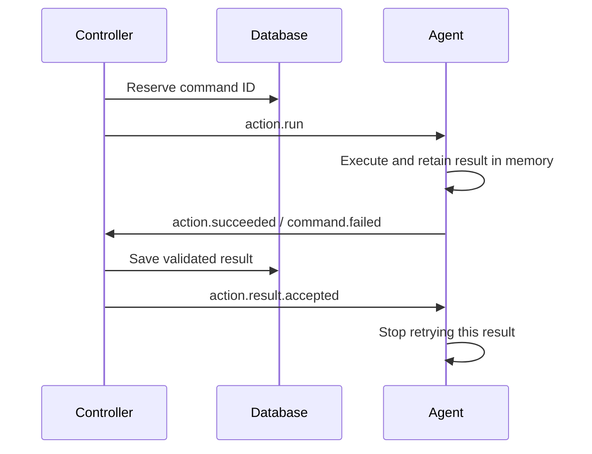

# Adapter, controller and agent messages

This package defines the common message envelope, wire type names and topic
routing helpers. [`comms.Bus`](../bus.go) transports messages; it does not choose
recipients. Command and event contracts
live in [`comms/clients`](../clients), grouped by recipient. Shared payloads live
with their domain models: `actions.ActionCall` and `actions.ActionOutput` in
[`domain/actions`](../../domain/actions), `agents.AgentSnapshot` in
[`domain/agents`](../../domain/agents), and `executions.CommandError` in
[`domain/executions`](../../domain/executions). The agent runtime also exposes
aliases for action authors.

For terminology, see [core abstractions](../../../docs/abstractions.md#messages-and-durable-execution).
For application boundaries, see the [architecture overview](../../../docs/overview.md#dependencies).

Controller command and event clients select the default controller destination
inside comms. Agents and adapters supply messages or method arguments; they do
not configure a controller type.

## Adapter → controller

[MCP](../../../apps/adapters/mcp/) forwards commands through the bus.
Definitions and client: [`controller/commands`](../clients/controller/commands).

MCP inputs use request names such as `StartOperationRequest`. The adapter maps
them to comms commands such as `StartOperationCommand`. A `CommandEnvelope`
contains the method, serialized command parameters, and deadline; the outer
`Message` supplies delivery IDs, correlation, and timestamps.

| Message | Destination | Purpose |
| --- | --- | --- |
| `adapter.request` | `controllers.<controller-type>.requests` | A method, its parameters and the caller's deadline |
| `adapter.request.canceled` | `controllers.<controller-type>.cancellations` | Cancel a request identified by `correlation_id` |
| `controller.response` | `adapters.<adapter-id>.replies` | Return the result or domain error, correlated to the request ID |

Responses are defined in [`adapter/events`](../clients/adapter/events).
Adapter messages use `adapter_id`; agent messages use `agent_id`. Each adapter
subscribes to its replies before publishing requests. Controller request
consumption is separate from agent events, so waiting for an action does not block
its result. Cancellation has a separate subscription for the same reason.

The adapter forwards deadlines and does not automatically retry commands: a
lost reply may follow a successful mutation. Inspect the operation before
resubmitting work. See [availability and recovery](../../../docs/overview.md#state-and-restart-recovery)
for query availability, subscriber requirements, and restart limits.

## Controller → agent

Publish commands to `agent.<agent-id>.commands`.
Definitions: [`agent/commands`](../clients/agent/commands).

| Message | Payload | Agent response |
| --- | --- | --- |
| `action.run` | `actions.ActionCall` | `action.succeeded` or `command.failed` |
| `agent.discover` | `commands.DiscoverActionsCommand` | `agent.updated` or `command.failed` |
| `agent.stop` | `commands.StopAgentCommand` | `agent.stopped` or `command.failed` |

Publish `action.result.accepted` with a `ResultReceipt` payload to
`agent.<agent-id>.receipts`. Its contract lives in
[`agent/events`](../clients/agent/events). It stops result retries and requires
no reply. Agents consume this topic independently so running an action does not
block receipts for earlier results.

## Agent → controller

Publish to `controllers.<controller-type>.events`.
Definitions: [`controller/events`](../clients/controller/events).

| Message | Payload | When sent |
| --- | --- | --- |
| `agent.started` | `agents.AgentSnapshot` | Discovery completes and the agent is ready |
| `agent.heartbeat` | `agents.AgentSnapshot` | Periodic inventory and lease refresh |
| `agent.updated` | `agents.AgentSnapshot` | Action discovery updates the inventory |
| `agent.stopped` | `agents.AgentSnapshot` | Graceful shutdown |
| `action.succeeded` | `actions.ActionOutput` | An action succeeds; output is inline or an artifact reference |
| `command.failed` | `executions.CommandError` | A command fails validation or execution |

## Correlation and acknowledgements

Runtime IDs identify individual processes: `<type>-agent-<8 hex characters>`,
`<type>-controller-<8 hex characters>`, and `<type>-adapter-<8 hex characters>`.
The suffix uses lowercase hexadecimal. Controller destinations use the stable
controller type, such as `default`. Comms owns that routing choice, so a controller
restart with a new process ID does not require agent or adapter configuration. Runtime records have no separate
name. Message, command, task, operation, report, and artifact IDs remain UUIDs.

Every [message](message.go) has its own `id`. `agent_id` identifies the sender
for events and the destination for commands. Replies set `correlation_id` to
the command's `id`; unsolicited announcements leave it empty. Action commands,
results, and receipts carry the same `work` identifiers for the operation and task.

The agent retries action results until a receipt matches the result ID, command ID,
and work context. The controller sends the receipt only after database persistence.
Receipts do not trigger another reply. Command IDs prevent repeat execution within
the same agent runtime. Queued-operation recovery may redeliver the exact saved
command to that same live instance; it never generates a replacement command ID
or sends unknown work to a replacement agent. Direct action calls and already
interrupted tasks retain observation-only recovery.
Graceful `agent.stop` waits up to five seconds for outstanding results to be
accepted. If they remain unaccepted, the agent responds with `command.failed`
and keeps running so delivery can continue.

`Subscription.Ack` separately acknowledges a broker delivery by message ID. It
allows the filesystem bus to remove handled messages. A broker ACK alone does
not confirm that a result reached the controller's database.

For storage locations, see [state layout](../../../docs/deployment.md#state).
For saved results and unknown outcomes after a restart, see
[restart recovery](../../../docs/overview.md#state-and-restart-recovery).
