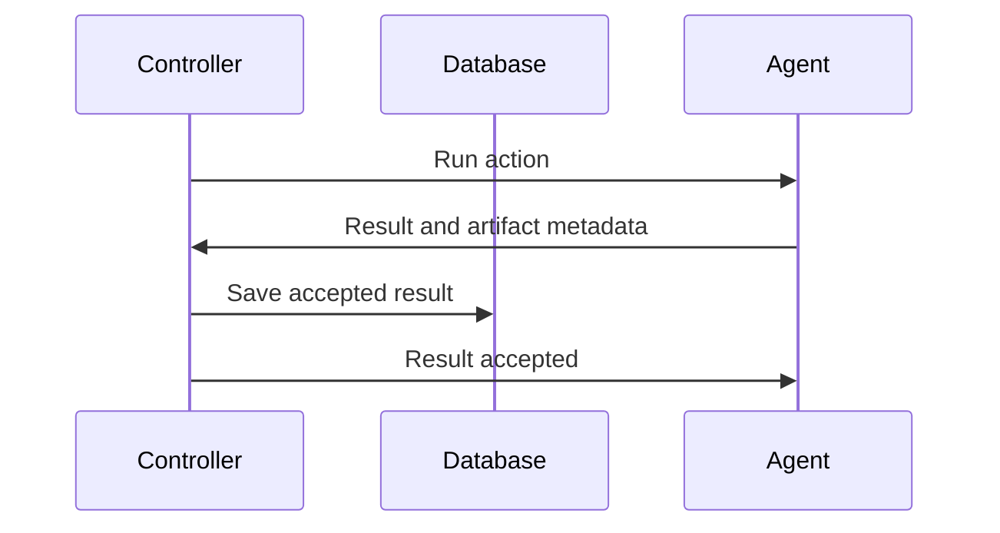

# Message contracts

Keep clients, controllers and agents aligned as operations cross process
boundaries. Typed commands and events preserve correlation IDs and work context
so execution messages can be associated with their operations and tasks.
Use the typed [`comms/clients`](../clients/) publishers and
[`routing.go`](routing.go) when constructing destinations.

## Destinations

Adapters submit commands to the controller; only the controller dispatches agent
work. See the [route helpers](routing.go) for exact topics and
[inbox modes](../README.md#delivery-guarantees) before opening subscriptions.

## Payloads

Find typed commands and events in [`clients`](../clients/), grouped by recipient.
The [`Message`](message.go) envelope carries identity, correlation and time.
Keep file bytes out of messages; upload them through an artifact file store.

## Correlation and acknowledgements

Subscribe before publishing. Preserve command IDs and operation/task context in
replies. Do not retry a mutation solely because its reply was lost.

Wait for the controller's result receipt before dropping a cached outcome. Broker
acknowledgement alone is insufficient. Process restarts lose in-memory replay
state; see [recovery limits](../../../docs/overview.md#state-and-restart-recovery).

## Execution checkpoints

Inside an action served by `Agent.Serve`, use
[`action.SaveCheckpoint` and `action.LoadCheckpoint`](../../agent/action/checkpoints.go)
to record or read a named JSON fact. Save identifiers needed to reconcile external
work; keep secrets and file contents out of checkpoints.

Checkpoint values are immutable. An identical save can be retried; a checkpoint
does not authorize repeating an external side effect. See
[checkpoint guidance](AGENTS.md) when changing the exchange.

## Execution logs

Call [`action.Log(ctx, message)`](../../agent/action/log.go) inside an action served
by `Agent.Serve` to report progress. Messages preserve up to 2048 bytes of nonblank
UTF-8 text. Keep secret values and file contents out of them.

Success confirms publication to the bus. The controller checks the saved execution
claim and stores the log before acknowledging its delivery; the action receives
no persistence receipt. Calls are not retried automatically, and another call
creates another observation. Logs do not extend task deadlines or replace
checkpoints.

Query saved operation logs through the
[HTTP API](../../../apps/adapters/api/README.md#execution-logs)
or MCP's [`operation_logs`](../../../apps/adapters/README.md#queries-and-artifacts).

## Secret synchronization contracts

Use [secret helpers](../../secrets/README.md#agent-requirements) in actions instead
of adding values to message payloads. The controller sends encrypted deliveries;
agents acknowledge them after installation.

Restrict bus access to trusted hosts. Deleting a secret does not immediately
revoke installed copies. See [secret runtime limits](../../secrets/README.md#agent-requirements)
and [wire implementation guidance](AGENTS.md).
