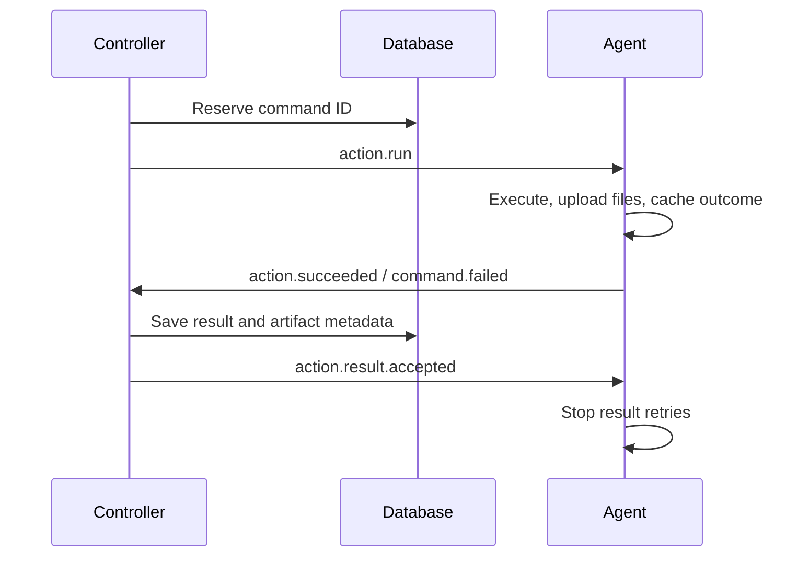

# Message contracts

This package owns the common envelope, wire types and routing helpers.
Typed commands/events and publishers live in [`comms/clients`](../clients), grouped
by recipient. Shared payloads live in `framework/domain`.

The direction of control is **Commander → Controller → Agent**. MCP forwards
operation commands, while queries read stores. Only the controller dispatches to
an agent instance. Agent results and status flow back to the controller.

## Destinations

Destinations are exact topic names. Comms selects the default controller route
for adapters and agents.

| Publisher → consumer | Destination | Messages |
| --- | --- | --- |
| Adapter → controller | `controllers.default.commands` | `adapter.request`: method, serialized command and deadline |
| Adapter → controller | `controllers.default.cancellations` | `adapter.request.canceled` |
| Controller → adapter | `adapters.<adapter-id>.replies` | `controller.response`: result or domain error |
| Controller → agent | `agents.<agent-id>.commands` | `action.run`, `agent.discover`, `agent.stop` |
| Controller → agent | `agents.<agent-id>.events` | `action.result.accepted`, `secret.delivered`, `execution.checkpoint.responded` |
| Agent → controller | `controllers.default.events` | Lifecycle events, action outcomes, checkpoint requests, secret requests and installation acknowledgements |

Use [`routing.go`](routing.go) to build destinations. Hosts use transient inboxes;
see [inbox lifetimes](../README.md#delivery-guarantees).

## Payloads

Find typed payloads under [`clients`](../clients/), grouped by recipient. The
[`Message`](message.go) envelope carries identity, correlation, routing and time.
Agent snapshots describe readiness and current work; action results carry
structured output and artifact metadata, never file bytes.
An executing work snapshot may include `missing_requirements`, using discovery's
requirement shape. These are execution-scoped observations, not action readiness
changes or secret values; match the saved command and work identity before
presenting them as a task's current wait.

Adapter requests include a deadline. Controller-to-agent commands carry
`expires_at`, the latest time new work can start. Cached outcomes remain
replayable after that time; see
[admission deadlines](../README.md#command-admission-deadlines).

## Correlation and acknowledgements

Replies set `correlation_id` to the command ID. Action commands, outcomes and
receipts carry the same operation/task `work` context. Adapters subscribe before
publishing and do not automatically retry mutations after a lost reply.

The receipt matches the result ID, command ID and work context. Outcome replay
can repair incomplete metadata persistence without rerunning the action. Command
deduplication and pending results last only for the agent process's lifetime.

`Delivery.Ack(ctx)` separately confirms successful processing of one delivery;
`Delivery.Reject(ctx)` records unsuccessful processing. Neither replaces the
controller's durable result receipt.

See [consumer behavior](../README.md) and
[restart recovery](../../../docs/overview.md#state-and-restart-recovery) for limits
on replay and unknown outcomes.

For changes to these contracts, see [coding guidance](AGENTS.md).

## Execution checkpoints

An action running through `Agent.Serve` can call
[`action.LoadCheckpoint` or `action.SaveCheckpoint`](../../agent/action/checkpoints.go)
to read or append a named JSON fact in its reserved execution. Standalone
`Agent.Work` has no checkpoint capability.

| Direction | Message | Correlation |
| --- | --- | --- |
| Agent → controller events | `execution.checkpoint.requested` | Original action command ID |
| Controller → agent events | `execution.checkpoint.responded` | Checkpoint request message ID |

The runtime binds each request to the accepted command's agent and work context.
The controller checks that identity against the saved execution claim, then
persists a save and reads it back before replying. Responses include the command
ID, checkpoint name and saved JSON, or a fixed error code. The agent processes
them through its independent event inbox while the action waits.

Lost replies and uncertain publications retry the same checkpoint request.
Identical saves confirm the immutable value; conflicting data fails. Waits end
with caller, action or host cancellation. Cancellation can leave a write's outcome
unknown. Checkpoints do not authorize rerunning an action, transferring execution
ownership or repeating an external side effect.

These replies are separate from broker acknowledgements and terminal result
receipts. Bus access remains the trusted publisher boundary; matching envelope
fields alone does not authenticate a process. See
[checkpoint limits](../../../docs/abstractions.md#results-and-evidence).

## Secret synchronization contracts

Agents request declared secrets automatically or request names on demand during
execution; the controller persists requests and
encrypted deliveries before publishing. Only successful installation makes
those secrets available to an action.

| Direction | Message | Correlation |
| --- | --- | --- |
| Agent → controller events | `secret.sync.requested` | Message ID is the pending request ID |
| Controller → agent events | `secret.delivered` | Request ID |
| Agent → controller events | `secret.installed` | Delivery message ID |

A request identifies one scoped secret and its recipient. Delivery contains an
encrypted secret and expires at the earlier of the request deadline or secret
expiry. An installation acknowledgement identifies the request, secret ID and
version; send it only after successful decryption and installation. These
messages carry no operation/task work context.

Typed validators match deliveries to requests and acknowledgements to the exact
delivery. The controller checks live inventory, the registered
agent type and current stored version. The agent matches its active request,
checks receipt-time expiry and authenticates ciphertext before installation.
Exact delivery retries repeat the original installation acknowledgement.

Broker acknowledgement does not fulfill a secret request, and historical
installation does not prove ongoing readiness. Periodic refresh uses fresh
requests; installed values have finite validity. Deletion is not immediate
revocation. See [runtime limits](../../secrets/README.md#agent-requirements).
Publishers remain trusted through deployment access to the bus; these messages
do not independently authenticate a process identity.
