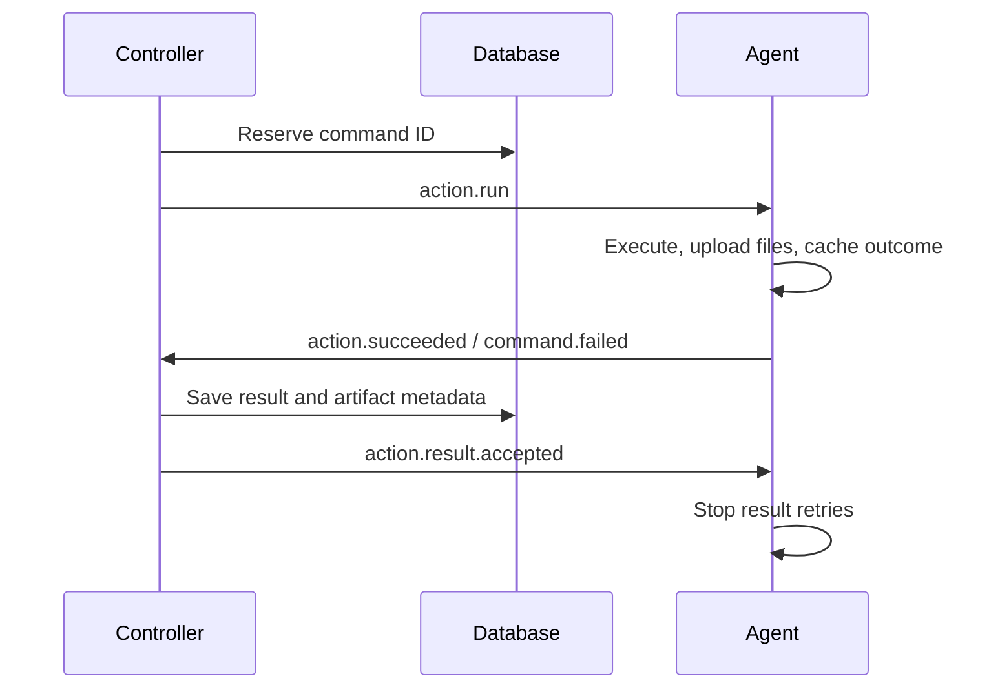

# Message contracts

This package owns the common envelope, wire types and routing helpers.
Typed commands/events and publishers live in [`comms/clients`](../clients), grouped
by recipient. Shared payloads live in `framework/domain`.

The direction of control is **Commander → Controller → Agent**. MCP forwards
operation commands, while queries read stores. Only the controller dispatches to
an agent instance. Agent results and status flow back to the controller.

## Destinations

These are the **current exact-topic destinations**, not RabbitMQ queues.
Comms selects the default controller route for adapters and agents.

| Publisher → consumer | Destination | Messages |
| --- | --- | --- |
| Adapter → controller | `controllers.default.commands` | `adapter.request`: method, serialized command and deadline |
| Adapter → controller | `controllers.default.cancellations` | `adapter.request.canceled` |
| Controller → adapter | `adapters.<adapter-id>.replies` | `controller.response`: result or domain error |
| Controller → agent | `agents.<agent-id>.commands` | `action.run`, `agent.discover`, `agent.stop` |
| Controller → agent | `agents.<agent-id>.events` | `action.result.accepted` |
| Agent → controller | `controllers.default.events` | Lifecycle events, `action.succeeded`, `command.failed` |

Destination names follow [`routing.go`](routing.go), including
`ControllerCommands(controllerType)` and `AgentEvents(agentID)`. Current inboxes
use `TransientExclusive` mode and the receiving process ID as their name, scoped
to the destination topic. See [inbox lifetimes](../README.md#delivery-guarantees).
The RabbitMQ provider is not implemented.

## Payloads

| Contract | Definition |
| --- | --- |
| Operation commands and request envelope | [`controller/commands`](../clients/controller/commands) |
| Action execution, discovery and stop commands | [`agent/commands`](../clients/agent/commands) |
| Agent snapshots and action outcomes | [`controller/events`](../clients/controller/events) |
| Result acceptance receipts | [`agent/events`](../clients/agent/events) |
| Adapter replies and encoded errors | [`adapter/events`](../clients/adapter/events) |

`agent.started`, `agent.heartbeat`, `agent.updated` and `agent.stopped` carry an
`AgentSnapshot`. Updates include readiness changes and work starting/finishing.
The `work` snapshot identifies the latest active assignment; it is not work history.
`action.succeeded` carries structured output and artifact metadata, never file bytes.

MCP input structs are requests; bus payloads are commands. A `CommandEnvelope`
contains the method, parameters and deadline. Its outer `Message` supplies delivery
identity, correlation, sender/destination and timestamps.

## Correlation and acknowledgements

Process IDs use `<type>-agent-<8hex>`, `<type>-controller-<8hex>` and
`<type>-adapter-<8hex>`. Replacing a process creates a new ID. Controller routing
uses a stable type inside comms; storage interfaces do not know that routing type.
Operation, task, command, message, report and artifact IDs use UUIDs.

Replies set `correlation_id` to the command ID. Action commands, outcomes and
receipts carry the same operation/task `work` context. Adapters subscribe before
publishing and do not automatically retry mutations after a lost reply.

The receipt must match the result ID, command ID and work context. If metadata
persistence fails, outcome replay can repair it without uploading files again or
rerunning the action. Agent command deduplication and pending results are held
in memory for that process's lifetime.

`Delivery.Ack(ctx)` separately confirms successful processing of one delivery;
`Delivery.Reject(ctx)` records unsuccessful processing. Neither replaces the
controller's durable result receipt. Receipts have their own subscription so
active actions cannot block them.

See [consumer behavior](../README.md) and
[restart recovery](../../../docs/overview.md#state-and-restart-recovery) for limits
on replay and unknown outcomes.
