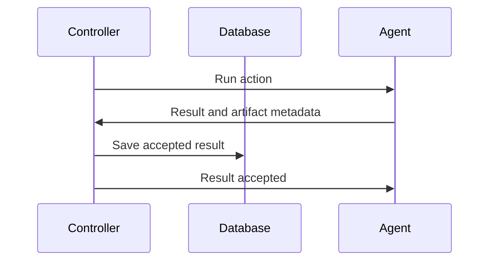

# Message contracts

Keep clients, controllers and agent integrations aligned as operations cross
service boundaries. Typed commands and events preserve correlation IDs and
explicit `operation_id` and `task_id` fields so teams can trace execution messages.
Use the typed [`comms/clients`](../clients/) publishers and
[`routing.go`](routing.go) when constructing destinations.

## Destinations

Adapters submit commands to the controller; only the controller dispatches agent
work. See the [route helpers](routing.go) for exact topics and
[inbox modes](../README.md#delivery-guarantees) before opening subscriptions.

## Payloads

Find typed commands and events in [`clients`](../clients/), grouped by recipient.
The [`Message`](message.go) envelope carries identity, correlation and time.
Keep file bytes out of messages; upload them through an artifact file store.

## Correlation and acknowledgements

Subscribe before publishing. Preserve command IDs and operation/task context in
replies. Do not retry a mutation solely because its reply was lost.

Wait for the controller's result receipt before dropping a cached outcome. Broker
acknowledgement alone is insufficient. Process restarts lose in-memory replay
state; see [recovery limits](../../../docs/overview.md#state-and-restart-recovery).

## Execution checkpoints

Inside an action served by `Agent.Serve`, use
[`action.SaveCheckpoint` and `action.LoadCheckpoint`](../../agent/action/checkpoints.go)
to record or read a named JSON fact. Save identifiers needed to reconcile external
work; keep secrets and file contents out of checkpoints.

Checkpoint values are immutable. An identical save can be retried; a checkpoint
does not authorize repeating an external side effect. See
[checkpoint guidance](AGENTS.md) when changing the exchange.

## Execution questions

Inside an action served by `Agent.Serve`, call
[`action.Question(ctx, key, text, options...)`](../../agent/action/questions.go)
and handle the returned question's `Answer`. Use a stable key for each decision
within that execution. Repeating a key reuses its question; changing its text or
options is rejected.

The controller saves the question for Playground/Admin. Operators can answer
immediately; a model client may answer after `fallback_at`. The action waits and
resumes after receiving the saved answer. Cancellation and task deadlines still
apply. Keep credentials in `action.RequestSecret`, outside question history.

## Execution logs

Call [`action.Log(ctx, message)`](../../agent/action/log.go) inside an action served
by `Agent.Serve` to report progress. Messages preserve up to 2048 bytes of nonblank
UTF-8 text. Keep secret values and file contents out of them.

Success confirms publication to the bus. The controller checks the saved execution
claim and stores the log before acknowledging its delivery; the action receives
no persistence receipt. Calls are not retried automatically, and another call
creates another observation. Logs do not extend task deadlines or replace
checkpoints.

Query saved operation logs through the
[HTTP API](../../../apps/adapters/api/README.md#execution-logs)
or MCP's [`operation_logs`](../../../apps/adapters/README.md#queries-and-artifacts).

## Shared data

Inside an action served by `Agent.Serve`, use
[`action.ReceiveSharedData(ctx)`](../../agent/action/sharing.go) to receive selected
results, artifact metadata or answered decisions from another task in the same
operation. Updates preserve source execution and existing record IDs for receiver
deduplication. Artifact bytes remain in file storage; shared decisions preserve
their original scope and answer origin without granting new authority.

The controller forwards accepted results, artifact metadata and saved task-scoped
answers according to the operation's saved `policies.sharing`. Reception
uses the existing agent event inbox while the action runs. Broker
acknowledgement does not prove the action processed an update. Receiver memory is
local, and live delivery provides no restart replay. Forwarding failures are
logged and do not change the producer's accepted outcome.

For aggregation groups, the same call receives controller-originated
`task.batch.started` and `task.batch.finished` notifications. Start identifies the
producer tasks permitted by the receiver's sharing routes; producer data carries
the same batch ID. Finish follows known outcomes for the whole group and reports
succeeded, failed or cancelled members. Interrupted work keeps the batch open.

Start the receiver before the group and keep it outside the producer membership.
Batch recipients are selected at start; later tasks and restarted receivers do
not join an existing batch. Decisions still follow live sharing routes and can
arrive after finish. A finish notification does not prove every result arrived.
Controller restarts lose batch enrollment, without replaying the earlier start.
See [data sharing](../../../docs/features/data-sharing.md) for mission setup.

## Secret synchronization contracts

Use [secret helpers](../../secrets/README.md#agent-requirements) in actions instead
of adding values to action inputs. The controller decrypts the saved secret and
sends its value and metadata only to the requesting agent. Agents acknowledge
installation without receiving the encryption key. Saved delivery history stays
encrypted.

An action can supply `SecretRequestOptions.Default` with a reusable request.
The controller saves it encrypted only when the shared name is missing; saved
values take precedence. The default travels through the trusted secret exchange,
outside action inputs and model context. Use AMQPS across networks.

Transient requests bind a value to one execution and deadline. Retries retain
their request and delivery identities; values remain in memory. A receipt means
the agent received the value, not that an external service accepted it.

Restrict bus access to trusted hosts. Deleting a secret does not immediately
revoke installed copies. See [secret runtime limits](../../secrets/README.md#agent-requirements)
and [wire implementation guidance](AGENTS.md).

Explore [11 practical Commander use cases](https://github.com/defos-ai/commander/blob/main/docs/use-cases.md):
security operations, authorized security testing, compliance monitoring,
multi-agent development, incident response, prospect research and outreach,
competitive intelligence, data processing, ticket resolution, infrastructure
monitoring and long-running research for universities and R&D centers.
