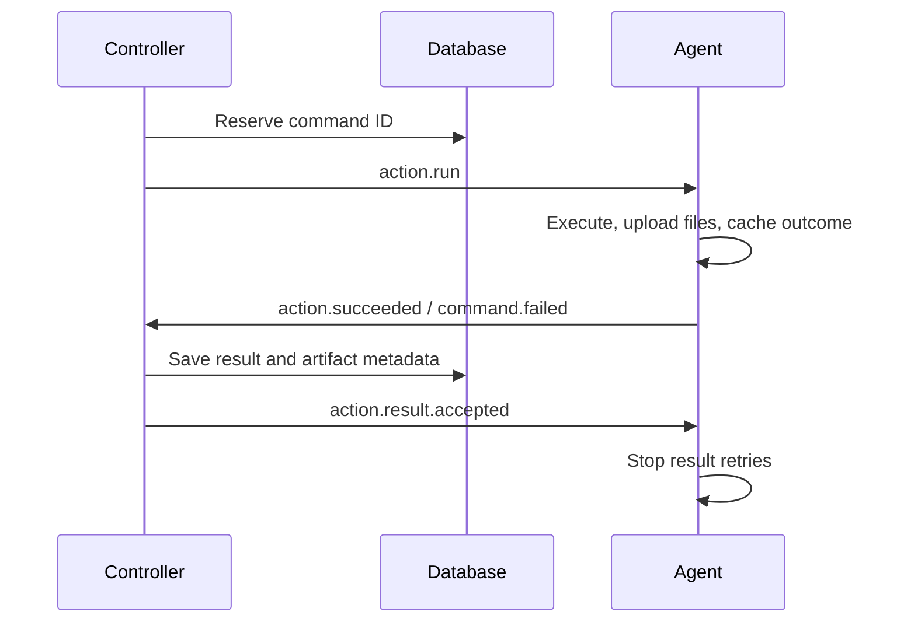

# Message contracts

This package owns the common envelope, wire types and routing helpers.
Typed commands/events and publishers live in [`comms/clients`](../clients), grouped
by recipient. Shared payloads live in `framework/domain`.

The direction of control is **Commander → Controller → Agent**. MCP forwards
operation commands, while queries read stores. Only the controller dispatches to
an agent instance. Agent results and status flow back to the controller.

## Destinations

Destinations are exact topic names. Comms selects the default controller route
for adapters and agents.

| Publisher → consumer | Destination | Messages |
| --- | --- | --- |
| Adapter → controller | `controllers.default.commands` | `adapter.request`: method, serialized command and deadline |
| Adapter → controller | `controllers.default.cancellations` | `adapter.request.canceled` |
| Controller → adapter | `adapters.<adapter-id>.replies` | `controller.response`: result or domain error |
| Controller → agent | `agents.<agent-id>.commands` | `action.run`, `agent.discover`, `agent.stop` |
| Controller → agent | `agents.<agent-id>.events` | `action.result.accepted` |
| Agent → controller | `controllers.default.events` | Lifecycle events, `action.succeeded`, `command.failed` |

Use [`routing.go`](routing.go) to build destinations. Hosts use transient inboxes;
see [inbox lifetimes](../README.md#delivery-guarantees).

## Payloads

Find typed payloads under [`clients`](../clients/), grouped by recipient. The
[`Message`](message.go) envelope carries identity, correlation, routing and time.
Agent snapshots describe readiness and current work; action results carry
structured output and artifact metadata, never file bytes.

Adapter requests include a deadline. Controller-to-agent commands carry
`expires_at`, the latest time new work can start. Cached outcomes remain
replayable after that time; see
[admission deadlines](../README.md#command-admission-deadlines).

## Correlation and acknowledgements

Replies set `correlation_id` to the command ID. Action commands, outcomes and
receipts carry the same operation/task `work` context. Adapters subscribe before
publishing and do not automatically retry mutations after a lost reply.

The receipt matches the result ID, command ID and work context. Outcome replay
can repair incomplete metadata persistence without rerunning the action. Command
deduplication and pending results last only for the agent process's lifetime.

`Delivery.Ack(ctx)` separately confirms successful processing of one delivery;
`Delivery.Reject(ctx)` records unsuccessful processing. Neither replaces the
controller's durable result receipt.

See [consumer behavior](../README.md) and
[restart recovery](../../../docs/overview.md#state-and-restart-recovery) for limits
on replay and unknown outcomes.

For changes to these contracts, see [coding guidance](AGENTS.md).
